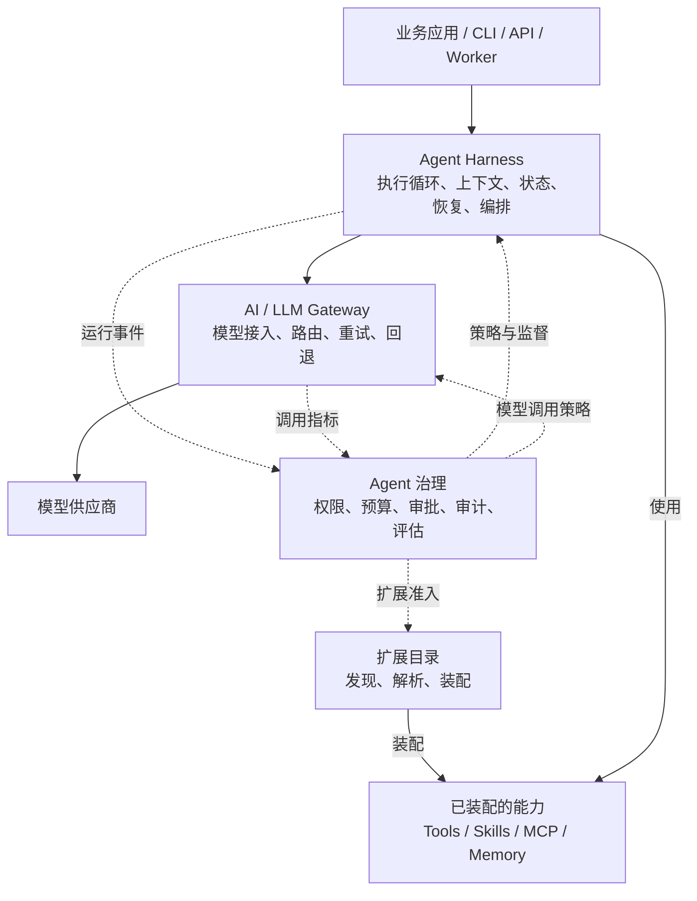

# goagent 四域架构重构分析

日期：2026-10-15  
状态：架构分析与目标设计建议，尚未实施

配套设计：[目录、文件与程序架构设计](goagent-four-domain-design.md)

## 1. 结论：四个方向合理，但应定义为架构域

将 goagent 划分为 AI/LLM Gateway、Agent Harness、扩展目录和 Agent 治理四个方向是合理的，也能对应当前代码中的职责。建议将其定义为**四个架构域**，而不是严格的上下四层。

- **AI/LLM Gateway**：提供统一、可靠的模型调用能力。
- **Agent Harness**：负责 Agent 的执行过程、状态与恢复。
- **扩展目录**：提供可发现、可装配的工具、技能和其他扩展。
- **Agent 治理**：定义运行规则，监督执行，并提供评估与管理能力。

Gateway 与 Harness 构成主要执行链路；扩展目录向运行时提供能力；治理横向作用于模型调用、扩展装配和 Agent 执行。

本文以当前仓库代码为依据。模块划分是目标设计建议，不表示这些模块现在都已经完整实现。

## 2. 为什么合理，又为什么不能直接堆成四层

这四个架构域分别回答不同的问题：

| 架构域 | 核心问题 | 主要管理对象 |
|---|---|---|
| AI/LLM Gateway | 模型怎样统一接入、选择和可靠调用？ | 模型、供应商、请求 |
| Agent Harness | 一个任务怎样持续执行、暂停、恢复和完成？ | Run、Thread、执行状态 |
| 扩展目录 | 有哪些能力可用，怎样发现、加载和装配？ | 工具、技能、扩展定义 |
| Agent 治理 | 谁可以做什么、花多少资源、执行效果如何？ | 策略、配额、审批、审计、评估 |

这种划分可以隔离不同类型的变化：

- 增加模型供应商，主要修改 Gateway。
- 改进循环、上下文管理和恢复机制，主要修改 Harness。
- 增加工具、Skill 或 MCP 接入，主要修改扩展域。
- 修改权限、预算和评估规则，主要修改治理域。

它们不适合形成 `治理 → 扩展 → Harness → Gateway` 的固定调用链。每次调用模型不需要经过扩展目录，工具执行也不需要经过模型网关。

下图中的箭头表示运行协作关系，不直接等同于 Go 包的 import 方向。

## 3. AI/LLM Gateway：统一模型访问与调用可靠性

### 3.1 职责边界

**处理一次模型能力调用，不负责完整的 Agent 任务。**

Gateway 接收 Harness 已准备好的请求，选择适合的模型，完成协议转换与调用，再返回标准化结果。

### 3.2 建议模块

| 模块 | 功能 | 当前代码基础或目标变化 |
|---|---|---|
| 模型契约 | 统一请求、响应、流式输出、错误、Usage | `llm/model.go`、`llm/error.go` |
| Provider 适配 | 对接不同供应商的协议、认证和流式格式 | `llm/anthropic`、`llm/openaicompat`、`llm/agnes` |
| 模型目录与能力描述 | 模型别名、支持的输入输出、工具调用能力、上下文限制 | 建议补充统一描述 |
| 路由与选择 | 按能力、配置、可用性等选择模型 | 在现有模型抽象上扩展 |
| 调用韧性 | 重试、超时、回退、熔断、并发限制 | 拆出 `middleware` 中相关实现 |
| 调用计量 | 记录每次尝试的时延、Usage、错误和费用估算 | 对接现有 Usage、观测能力 |
| 其他模型能力适配 | Embedding、图像生成、视频任务 | `embeddings`、`llm/image.go`、`llm/video.go` |

当前 [llm.Model](../../llm/model.go) 只要求模型名称和流式生成方法。重构时可以让 Gateway 对 Harness 继续暴露这个小接口，把路由和韧性实现放在内部。

当前 [RetryModel](../../middleware/retry.go) 明确是模型装饰器，并且只在尚未输出任何响应时重试。它在职责上属于 Gateway。

### 3.3 关键边界

- **模型请求重试归 Gateway；任务恢复和工具重试归 Harness。** 后两者可能涉及副作用，不能套用同一种重试策略。
- **上下文选择与压缩归 Harness。** Gateway 可以检查请求是否超过模型能力限制，但不宜擅自修改会话历史。
- **不同模型能力使用不同接口。** Chat、Embedding、图像生成、视频异步任务可以同属 Gateway 域，但不应强行塞进一个巨大接口。

初期可以把 Gateway 实现为进程内 Go 模块。是否独立部署，取决于以后是否需要多应用共享凭证、路由和配额。

## 4. Agent Harness：完整的 Agent 执行系统

### 4.1 职责边界

> 把 Agent 定义、模型和扩展能力，变成一次有明确状态、可控制、可恢复的执行。

当前 [AgentLoop](../../agent/loop.go) 已经包含准备上下文、调用模型、执行工具、保存检查点和应用控制指令等阶段；[RunContext](../../agent/runtime.go) 承载一次执行的状态和运行依赖。因此，Harness 是对现有核心职责的整理，不需要从零构建。

### 4.2 建议模块

| 模块 | 功能 | 当前代码来源 |
|---|---|---|
| Agent 定义与装配 | 指令、模型引用、工具集合、运行配置 | `agent` 的构造与配置 |
| 执行引擎 | 模型—工具循环、阶段切换、结束条件 | `agent/loop.go`、`agent/runnable.go` |
| Run 生命周期 | 启动、等待、取消、steering、终止与结果 | `agent/run*.go`、`agent/terminal.go` |
| 上下文管理 | Prompt 组装、历史选择、窗口预算、压缩、检索注入 | `prompt`、部分 `middleware`、记忆集成 |
| 工具执行 | 查找工具、校验参数、并发控制、超时、结果回填 | `agent/exectools.go`、`tool` 的契约与校验 |
| 会话与状态 | Thread、Session、历史、分支与快照 | `agent/session.go`、`core/state.go` |
| 持久执行 | 检查点、暂停恢复、执行权协调、恢复一致性 | `checkpoint`、`agent/durable*`、`agent/hitl.go` |
| 编排 | 子 Agent、委派、串行、并行、循环、DAG | `agent/subagent.go`、`workflow.go`、计划执行相关代码 |
| 后台执行 | 任务投递、Worker、租约、心跳、取消与重连查询 | `queue`、`runstore`、managed run |
| 执行环境 | Workspace、文件系统、产物、沙箱调用 | `workspace`、`vfs`、`sandbox` |

### 4.3 状态所有权

**执行状态必须有明确的唯一负责人。**

当前 [runstore](../../runstore/record.go) 已经区分：

- `checkpoint`：已提交的状态快照。
- `runstore`：任务进度、执行者、取消请求和执行结果。

重构时应该保留这个区分。治理层可以查询状态、发起取消或审批，但应通过 Harness 的控制接口改变执行，避免自己维护另一套 Run 状态机。

### 4.4 人工审批的职责拆分

- 治理决定是否需要审批、谁能审批、审批是否有效。
- Harness 负责持久暂停、保存待执行动作、接受决定并正确继续。

## 5. 扩展目录：能力发现与装配

### 5.1 职责边界

这里将“扩展目录”理解为 **Extension Catalog，即能力目录与装配体系**。如果只是把扩展代码放进一个文件夹，它还不足以承担独立架构域的职责。

> 描述可用能力，发现并解析它们，按照运行配置装配出可供 Harness 使用的实例。

### 5.2 建议模块

| 模块 | 功能 | 当前基础或目标变化 |
|---|---|---|
| 扩展描述 | 名称、类型、版本、配置格式、所需权限、依赖 | 分散在工具、Skill 等定义中 |
| Catalog / Registry | 注册、发现、查询、命名冲突处理 | `skills.Library` 等局部能力 |
| Loader / Resolver | 从目录、内嵌资源或配置加载扩展并解析依赖 | `skills/loaddir.go`、`workspace` |
| 实例装配与生命周期 | 创建实例、注入依赖、连接建立和关闭、作用域管理 | 建议统一职责 |
| 工具扩展 | 文件、命令、Web、业务函数等具体能力 | `tool/file`、`tool/exec`、`tool/web` |
| Skill 扩展 | 指令、资源和脚本的渐进式加载 | `skills` |
| MCP 扩展 | 连接外部工具服务，发现并适配远程能力 | `tool/mcp` |
| 记忆与检索扩展 | 提供存储、检索、记忆策略等可替换实现 | `memory` 及其子包 |

### 5.3 定义、执行和授权分离

需要区分三件事：

1. 工具是什么、如何发现与装配：扩展目录负责。
2. 某次运行何时调用工具、如何回填结果：Harness 负责。
3. 本次调用是否获准：治理负责。

例如，一个文件写入工具属于扩展实现，但参数校验、运行超时和结果记录由 Harness 统一组织，文件访问权限由治理策略约束，再由具体文件系统后端执行限制。

当前 [skills](../../skills/skill.go) 已经具备元数据、按需加载指令和资源的基础。但 [skills.Gate](../../skills/gate.go) 又直接涉及 Agent 中间件和权限判断。这正是可以拆开的地方：

- Skill 包保留资源与权限需求声明。
- 治理模块解释这些声明，并结合全局策略决定授权。
- Harness 执行对应的放行、拒绝或暂停动作。

**扩展声明自己需要什么权限，不应等同于自己授予权限。**

记忆能力也要按职责拆分：Harness 决定何时检索、选哪些内容进入上下文；扩展提供检索和存储实现。不能机械地移动整个 `memory` 目录，就认为边界已经清楚。

## 6. Agent 治理：规则、监督与质量管理

### 6.1 职责边界

治理层围绕三类能力组织：**执行前准入、执行中控制、执行后分析**。

### 6.2 建议模块

| 模块 | 功能 | 当前基础或目标变化 |
|---|---|---|
| 身份与执行范围 | 用户、租户、Agent、Workspace 的身份和作用域 | 按产品需求补充，不能假定现有线程隔离等于租户授权 |
| 策略与权限 | 工具授权、模型访问、资源访问、扩展准入 | `middleware/permission.go`、Skill Gate、Workspace 策略 |
| 人工审批 | 审批规则、决定记录、审批有效性 | 与 `agent/hitl.go` 分工 |
| 预算与配额 | Run、用户、租户级 Token、费用、时长和并发限制 | `middleware/runbudget.go` 等 |
| 运行保护策略 | 循环异常、连续拒绝、超时、资源超限的处理规则 | LoopGuard、ArgGuard、ToolTimeout 等 |
| 审计 | 谁在什么规则下调用了什么，结果如何 | 基于运行事件构建，不能直接把普通日志当完整审计 |
| 可观测性 | Trace、指标、错误率、成本和执行轨迹 | `logger`、`obs/otel`、Tracing |
| 评估与质量门禁 | 离线回归、轨迹评分、在线结果检查 | `eval` |
| 管理接口 | 查询、审批、取消、策略配置和版本管理 | 对接 Harness 的控制接口 |

### 6.3 治理决策与执行机制的边界

| 场景 | 治理负责 | 实际执行方负责 |
|---|---|---|
| 禁止某工具调用 | 决定拒绝并给出原因 | Harness 在工具运行前阻止调用 |
| 限制运行费用 | 制定额度与超限规则 | Gateway 上报调用用量，Harness 在执行边界采取动作 |
| 要求人工确认 | 判断审批要求和决定有效性 | Harness 持久暂停并继续执行 |
| 限制命令环境 | 制定允许的命令和资源范围 | Sandbox 后端落实约束 |
| 质量不达标需重做 | 给出评分和处理策略 | Harness 决定如何继续下一步执行 |

治理不能只靠事后的事件订阅。权限和额度需要在关键执行点同步检查；事件订阅更适合审计、监控和离线分析。

把 `sandbox` 放到治理目录不会自动产生更强隔离。当前 [Sandbox 契约](../../sandbox/sandbox.go) 明确区分了现有进程后端的限制和未来更强隔离后端。策略、执行机制和隔离能力是三个不同的问题。

当前 [eval.Harness](../../eval/harness.go) 是离线评测执行器，与本文的 Agent Harness 不是同一个概念；文档和包命名需要说明清楚。

## 7. 当前最值得重构的职责交叉

与其先把所有目录搬到四个父目录下，应优先处理以下四处职责交叉。

### 7.1 拆分 middleware 的职责

| 当前能力 | 目标归属 |
|---|---|
| RetryModel、FallbackModel、CircuitBreaker | Gateway |
| Window、Compaction、RAG 上下文注入 | Harness 的上下文管理 |
| Permission、RunBudget、运行保护规则 | 治理策略 |
| 中间件接口、阶段钩子、指令执行机制 | Harness |
| Tracing 接入 | 治理/观测适配 |

`RateLimit` 需要进一步区分：供应商请求限流属于 Gateway，用户和租户配额属于治理。

### 7.2 拆开扩展定义与运行集成

`skills`、`workspace`、记忆模块中涉及 Agent 钩子的部分，可以成为单独的集成适配模块。这样读取和解析一个 Skill，就不必引入整个执行系统。

### 7.3 保持运行状态与控制入口集中

Run、Thread、Checkpoint、任务记录、恢复协调都应处于 Harness 的职责范围。后台执行是 Harness 的一种执行方式，不能因为它涉及“管理”就整体归入治理。

### 7.4 收紧公共契约，避免循环依赖

让 Harness 依赖小接口，而不是具体实现：

- 调模型依赖模型接口。
- 用工具依赖工具执行接口。
- 发现扩展依赖解析或装配结果。
- 检查策略依赖决策接口。
- 发布观测信息依赖事件接口。

治理和扩展通过这些接口接入。不建议为解决 import 问题，把所有类型都搬进一个越来越大的 `core` 包。

## 8. 重构方案与建议顺序

### 8.1 方案比较

| 方案 | 优点 | 主要问题 |
|---|---|---|
| 直接把现有包搬进四个目录 | 结构变化直观 | 职责交叉依然存在，还容易造成公开 API 破坏 |
| **先明确四个职责域，再逐步调整包边界** | 能保留现有能力，逐步验证边界 | 需要逐项确定状态和策略归属 |
| 直接拆成多个独立服务 | 可分别部署与扩缩容 | 当前会引入额外的网络、状态一致性和运维成本 |

推荐第二种方案。

### 8.2 建议顺序

1. **明确边界和契约**：确定模型请求、运行状态、扩展定义、策略决定各归谁负责。
2. **整理 Gateway**：把模型级韧性从混合中间件中抽出。
3. **整理 Harness**：按执行、上下文、持久化、编排和后台任务组织内部职责。
4. **建立扩展目录与集成适配**：分开能力描述、实例装配和执行过程。
5. **整合治理能力**：复用现有权限、预算、评估与观测代码，补齐一致的策略入口。

### 8.3 行为验收重点

- 流式输出是否重复。
- 工具副作用是否被重复执行。
- 审批是否可绕过。
- 暂停恢复是否正确。
- 后台任务状态是否一致。
- 动态工具是否仍保持运行隔离。

## 9. 架构命名建议

保留原先提出的四个方向，并正式表述为：

1. **模型访问域（AI/LLM Gateway）**。
2. **Agent 执行域（Agent Harness）**。
3. **扩展供给域（Extension Catalog & Integration）**。
4. **治理域（Agent Governance）**。

这个划分既能表达整体架构，也能指导 goagent 的包边界和职责重构。本文仅记录架构分析与设计建议，不代表实现已经变更。
