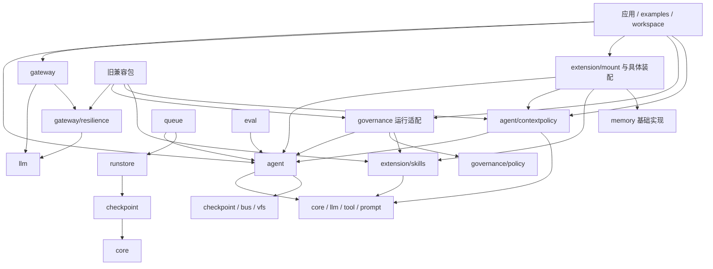
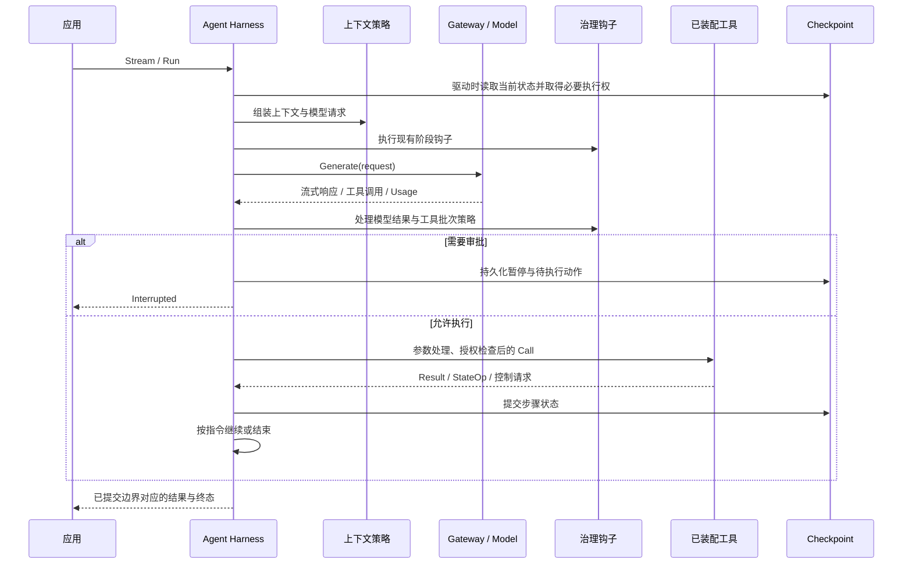

# goagent 四域重构：目录、文件与程序架构设计

- 日期：2026-10-15
- 状态：建议设计，尚未实施；不改变现有代码、公开 API 或存储格式。
- 前置分析：[goagent 四域架构重构分析](goagent-four-domain-architecture.md)
- 已选方案：先明确四个职责域，再逐步调整包边界。
- 设计范围：程序目录组织、关键文件职责、包依赖、运行协作、迁移与验收。

## 1. 总体决策

采用 **单 Go module、四个职责域、保留稳定公共契约、由应用显式装配** 的架构。

| 职责域 | 主要入口 | 配套包 | 重构原则 |
|---|---|---|---|
| 模型访问域 | `gateway/` | `llm/`、模型供应商适配、`embeddings/` | 在现有模型接口上增加路由与可靠性，不把一次模型调用变成 Agent 任务 |
| Agent 执行域 | `agent/` | `prompt/`、`checkpoint/`、`runstore/`、`queue/`、`bus/`、`vfs/`、`sandbox/` | 保持执行状态、恢复和终态的一致所有权 |
| 扩展供给域 | `extension/` | `tool/`、`memory/`、既有扩展兼容入口 | 分离扩展描述、实现、装配和运行时调用 |
| 治理域 | `governance/` | `eval/`、`obs/`、`logger/` | 分离规则决策、执行钩子、观测和评估 |

`core/` 是跨域值类型；`config/`、`workspace/` 和应用入口承担配置或装配职责。它们不构成第五个业务域，也不需要为凑齐四个目录而迁移。

### 1.1 为什么保留 agent，而不立即改名为 harness

Harness 是职责名称，`agent` 是已经存在的公开包名。当前 `Agent`、`Run`、`Session`、工作流和恢复机制都位于这个包。

[agent/runnable.go](../../agent/runnable.go) 的 `Runnable` 包含未导出的 `run(*RunContext) runOutcome` 方法，`runOutcome` 也未导出。工作流和循环通过这个包内契约协作，不能直接移动到 `agent/workflow` 子包后仍按原方式实现它。

因此：

1. 当前重构以 `agent/` 作为 Harness 的规范实现路径。
2. 先按文件职责整理执行内核，不为每个概念建立独立包。
3. 将依赖执行接口的策略实现移至独立包。
4. 只有当工作流形成真实独立契约，才讨论抽取工作流子包。
5. `harness/` 目录不是完成本次重构的验收条件。

同样，本设计不立即把 Agent 定义与执行实例拆成两套新对象，不引入 RuntimePool，也不把四域拆成四个服务。

### 1.2 区分职责重构与新增能力

- **职责重构**：迁移已有重试、回退、上下文管理、权限、预算、Skill Gate、记忆集成；保持行为。
- **新增能力**：统一扩展目录、模型目录与能力路由、模型尝试级计量、策略版本、多租户配额等。
- 先完成职责重构；新增能力分独立变更实施，不能用目录迁移掩盖行为变化。
- 下文目录树是收敛后的建议组织。标注“后续”的文件或模块，不要求第一阶段创建空壳。

## 2. 当前依赖核对与约束

本次通过 `go list` 核对的代表性仓库内直接依赖如下：

```text
agent        -> bus, checkpoint, core, llm, prompt, tool, vfs
llm          -> core
tool         -> core, llm
prompt       -> core, tool
middleware   -> agent, core, llm
skills       -> agent, core, prompt, sandbox, tool
memory/memx  -> agent, memory 及其子包, middleware, prompt, tool 等
workspace    -> agent, skills, memory/projectmem, memory/rules,
                sandbox, sandbox/process, tool/file, vfs 等
checkpoint   -> core, internal/paging, internal/watch
runstore     -> checkpoint, core, internal/paging, internal/watch
queue        -> agent, bus, checkpoint, core, runstore
eval         -> agent, core, embeddings, llm
```

这些依赖形成三个设计约束：

- 当前 `agent` 没有反向依赖 `middleware`、`skills`、`workspace`、`queue` 或 `eval`。应保留这一方向。
- `skills` 与 `memory/memx` 混合了资源能力和执行集成，需要把这类职责明确分开。
- `workspace` 已经是便利装配模块，不应伪装为执行内核必须依赖的底层包。

## 3. 程序目录架构

### 3.1 建议的收敛目录

目录中 `doc.go` 只在需要说明包契约时建立。目录不一定都是 Go package，例如 `extension/` 可以仅作为子包的组织目录。

```text
goagent/
├── go.mod                         # 保持一个 module
│
├── core/                          # 已有共享值类型、事件、状态与指令
├── llm/                           # 保留模型接口及供应商适配路径
│   ├── model.go
│   ├── error.go
│   ├── options.go
│   ├── image.go
│   ├── video.go
│   ├── anthropic/
│   ├── openaicompat/
│   ├── agnes/
│   └── mock/
├── embeddings/                    # 保留专用 Embedding 契约
│
├── gateway/                       # 模型访问域
│   ├── gateway.go                 # 后续：组合模型目录、路由与调用链
│   ├── catalog.go                 # 后续：模型标识、别名、能力
│   ├── route.go                   # 后续：选择模型，不选择 Agent
│   ├── attempt.go                 # 后续：每次真实模型调用的标识与记录
│   ├── options.go                 # 后续：Gateway 显式配置
│   └── resilience/                # 首先迁入已有模型装饰器
│       ├── retry.go
│       ├── fallback.go
│       └── circuit.go
│
├── agent/                         # Agent Harness；保留公开入口
│   ├── agent.go
│   ├── options.go
│   ├── run.go
│   ├── result.go
│   ├── session.go
│   ├── runtime.go
│   ├── runnable.go
│   ├── loop.go
│   ├── loopctx.go
│   ├── exectools.go
│   ├── middleware.go              # 钩子契约与执行栈，不放具体业务策略
│   ├── hitl.go
│   ├── durable_runtime.go
│   ├── run_prepare.go
│   ├── terminal.go
│   ├── write_guard.go
│   ├── dispatch_guard.go
│   ├── managed_run.go
│   ├── workflow.go
│   ├── pipeline.go
│   ├── plan.go
│   ├── planning.go
│   ├── subagent.go
│   ├── transfer.go
│   └── contextpolicy/             # 可选上下文策略；依赖 agent，反向禁止
│       ├── window.go
│       ├── compaction.go
│       └── rag.go
├── prompt/                        # Prompt 组合契约与实现
├── checkpoint/                    # 已提交状态、恢复协议、claim 与 fencing
├── runstore/                      # 可重连任务记录；不保存会话快照副本
├── queue/                         # 后台投递、执行 worker 与任务控制
├── bus/                           # 运行事件传输
├── vfs/                           # 文件后端
├── sandbox/                       # 命令执行契约
│   └── process/                   # 现有进程后端
│
├── tool/                          # 保留工具契约、泛型构造与参数校验
│   ├── file/                      # 迁移后兼容旧路径
│   ├── exec/                      # 迁移后兼容旧路径
│   ├── web/                       # 迁移后兼容旧路径
│   └── mcp/                       # 迁移后兼容旧路径
├── memory/                        # 保留存储、检索和基础记忆实现
│   ├── rules/
│   ├── projectmem/
│   ├── workingmem/
│   ├── textmem/
│   └── memx/                      # 迁移完成后成为旧装配入口的兼容包
├── extension/                     # 扩展供给域
│   ├── catalog/                   # 后续：只管理描述、版本和发现
│   │   ├── descriptor.go
│   │   ├── registry.go
│   │   └── resolve.go
│   ├── mount/                     # 多种扩展需要统一装配结果时再建立
│   │   └── bundle.go
│   ├── skills/                    # skills 的资源、加载、工具与 Prompt 实现
│   │   ├── skill.go
│   │   ├── frontmatter.go
│   │   ├── loaddir.go
│   │   ├── active.go              # 激活记录及读取；不做授权决定
│   │   ├── section.go
│   │   ├── tool.go
│   │   └── script.go
│   ├── memory/                    # 由 memory/memx 迁入的装配与运行集成
│   │   ├── memory.go
│   │   ├── budget.go
│   │   ├── consolidate.go
│   │   └── consolidation.go
│   ├── tools/                     # 具体工具逐个迁移，不改变 tool.Tool
│   │   ├── file/
│   │   ├── exec/
│   │   └── web/
│   └── mcp/                       # MCP 协议、连接与工具适配
│
├── governance/                    # 治理域
│   ├── policy/                    # 规则与决定；不依赖 agent
│   │   ├── decision.go
│   │   └── rule.go
│   ├── permission/                # 策略到 Harness 钩子的适配
│   │   └── permission.go
│   ├── skillgate/                 # Skill 权限声明与运行授权的集成
│   │   └── gate.go
│   ├── budget/                    # 保留已有 RunBudget 语义
│   │   ├── budget.go
│   │   └── report.go
│   ├── guard/                     # 运行保护策略
│   │   ├── loop.go
│   │   ├── arguments.go
│   │   └── tooltimeout.go
│   ├── throttle/                  # 原 BeforeModel 限流钩子，先保持语义
│   │   └── ratelimit.go
│   ├── tracing/                   # Agent 追踪钩子
│   │   └── tracing.go
│   ├── gatewayadapter/            # 后续：策略到模型尝试的授权/计量适配
│   └── audit/                     # 后续：审计记录与存储接口
├── eval/                          # 治理域的现有评估包；保留公开路径
├── obs/otel/                      # 保留遥测实现
├── logger/                        # 保留日志基础能力
│
├── workspace/                     # 高层环境装配；不被 agent 依赖
├── config/                        # 配置加载与解析
├── middleware/                    # 迁移完成后仅保留旧 API 兼容转发
├── skills/                        # 迁移完成后兼容 extension/skills 与 Skill Gate
├── internal/
│   ├── paging/
│   ├── watch/
│   ├── reporoot/
│   ├── sse/
│   └── archtest/                  # 实施时加入依赖约束测试
├── examples/                      # 显式装配示例与 API 兼容验证
└── docs/
    ├── analysis/
    ├── design/
    ├── adr/
    └── tasks/
```

该树展示重要文件及目录，并非要求删除未列出的当前文件。现有测试文件随实现迁移，兼容包另外保留旧入口测试。

### 3.2 为什么还有根目录下的配套包

逻辑归属不等于必须改变 import path。

- `llm.Model`、`tool.Tool`、`checkpoint.Checkpointer` 已是公共契约；移动路径会影响调用者。
- `eval`、`obs/otel` 和 `logger` 可以逻辑归属治理域，同时保留公开路径。
- `memory` 的基础存储不因扩展目录存在就必须依赖 Catalog。
- `sandbox` 提供执行机制，治理规定约束，两者不混为一包。
- `workspace` 可以依赖多个域完成组装；执行内核不依赖它。

### 3.3 单 module 与 internal 的使用

继续使用当前 `github.com/jiujuan/goagent` module。不要同时引入 `gateway/go.mod`、`agent/go.mod` 等子模块。

公共契约放在现有公开包中；真正仅供实现使用的代码才放入 `internal/`。不要让用户实现公开接口时，必须引用只能在仓库内部访问的类型。Go 工具本身并不会阻止同一 module 内所有不合意的跨域依赖，因此还需要显式 import 约束。

## 4. 程序文件架构

### 4.1 Gateway 的文件职责

| 目标文件 | 内容 | 明确不负责 |
|---|---|---|
| `llm/model.go` | 保留 `Model`、`Request`、`Response`、`ToolSchema` | Agent 状态、供应商配置中心 |
| `gateway/resilience/retry.go` | 模型调用重试及退避 | 工具重试、Run 恢复 |
| `gateway/resilience/fallback.go` | 输出前的供应商回退 | 输出后的静默切换 |
| `gateway/resilience/circuit.go` | 供应商级熔断状态 | Thread 状态 |
| `gateway/catalog.go` | 后续模型定义、别名、能力查询 | 工具与 Skill 目录 |
| `gateway/route.go` | 后续按请求约束选取候选模型 | 工作流 DAG、子 Agent 委派 |
| `gateway/attempt.go` | 后续记录真实调用尝试、用量、失败与未知用量 | 维护 Run 累计快照 |
| `gateway/gateway.go` | 后续组合路由、候选模型和装饰器 | 持久化会话 |

第一阶段只需要 `gateway/resilience`。`llm/anthropic` 等适配器保持原位置，避免为了目录整齐增加一套同义包。

后续 Gateway 的聊天入口继续实现 `llm.Model`。Embedding、图像、视频保留各自契约，不把它们强行合并到 `Generate`。

### 4.2 Harness 的文件分组

这些分组首先在同一个 `agent` 包内成立，不意味着每组都变成子包。

| 文件组 | 关键文件 | 维护的不变量 |
|---|---|---|
| 公开入口与构造 | `agent.go`、`options.go`、`result.go`、`session.go` | 保留 Run/Stream/Session 入口和返回契约 |
| 生命周期 | `run.go`、`run_prepare.go`、`terminal.go` | 惰性驱动、终态发布、结果冻结与提交边界一致 |
| 执行上下文 | `runtime.go`、`loopctx.go` | Run 状态与每步视图分离；动态工具不跨 Run 泄漏 |
| 循环与调用 | `loop.go`、`exectools.go` | 模型—工具顺序、参数处理、串并行执行与结果回填 |
| 钩子机制 | `middleware.go` | 钩子顺序、Directive 合并、硬策略检查语义 |
| 暂停与恢复 | `hitl.go`、`durable_runtime.go`、`inbox.go` | 审批记录、待执行动作、恢复与消费确认一致 |
| 并发执行权 | `write_guard.go`、`dispatch_guard.go` | 租约、fencing、过期执行者不得提交 |
| 编排 | `runnable.go`、`workflow.go`、`pipeline.go`、`plan.go`、`planning.go`、`branchmerge.go` | 子执行结果和控制指令组合，确定性分支合并 |
| 委派 | `subagent.go`、`transfer.go` | 子 Agent 上下文、传递与深度约束 |
| 后台集成 | `managed_run.go`、`run_status.go` | 运行入口与后台记录的关联，不复制 Worker 状态机 |

如果后续文件过大，可以先把 `loop.go` 中私有实现拆成 `loop_model.go`、`loop_tools.go` 等同包文件。不要仅为缩小单文件而导出 `runOutcome` 或建立循环依赖。

`agent/contextpolicy` 是可选策略包，依赖 `agent.Middleware`；`agent` 本身禁止 import 这个子包。目录嵌套不代表父包必须依赖子包。

### 4.3 扩展的文件职责

| 文件或包 | 内容 | 约束 |
|---|---|---|
| `extension/catalog/descriptor.go` | 后续定义 ID、版本、种类、来源、摘要、权限需求 | 不包含 `*Agent`、打开的连接或密钥 |
| `extension/catalog/registry.go` | 后续注册、查询、命名冲突处理 | 不直接调用工具，不成为全局可变单例 |
| `extension/catalog/resolve.go` | 后续解析明确的扩展引用 | 第一版只做显式引用与版本检查，不实现复杂包管理器 |
| `extension/skills/skill.go` | Skill 元数据与资源访问 | 不依赖 `agent`、`governance` |
| `extension/skills/active.go` | 现有激活键及读取逻辑 | 保留持久化键，不把声明视为授权 |
| `extension/skills/section.go` | Prompt 片段 | 不操作执行循环 |
| `extension/skills/tool.go`、`script.go` | Skill 读取工具、脚本调用适配 | 使用 `tool`、`sandbox` 契约 |
| `extension/memory/memory.go` | 从 memx 迁入的记忆装配 | 可以依赖 agent/contextpolicy，不依赖旧 middleware |
| `extension/memory/consolidation.go` | RunFinisher 集成 | 保留现有结束、暂停、恢复语义 |
| `extension/mount/bundle.go` | 必要时提供 Tools、Sections、Middleware 的装配结果 | 明确是高层集成包，Catalog 不依赖它 |
| `extension/tools/*` | 具体工具实现 | 不持有 Agent，不自行推进循环 |
| `extension/mcp` | 协议、传输、连接、远程工具适配 | 连接生命周期由创建者管理 |

目录描述与可运行对象分开：Catalog 返回描述；具体 Loader/装配代码创建工具、Prompt 片段和钩子。不要用一个 `Resolve(name) any` 承担全部扩展类型。

初期没有必要建立通用 `Plugin` 巨型接口、Go 动态插件加载器或远程扩展市场。现有静态注册、文件加载和 MCP 已提供具体装配场景。

### 4.4 治理的文件职责

| 文件或包 | 内容 | 约束 |
|---|---|---|
| `governance/policy/decision.go` | Allow/Ask/Deny 等决定类型 | 不依赖 agent，不持有可变 RunContext |
| `governance/policy/rule.go` | 首先提取已有工具规则；后续扩展资源规则 | 第一阶段可依赖 core.ToolCall，避免提前通用化 |
| `governance/permission/permission.go` | 决定到 BeforeTool/ToolPolicyChecker 的适配 | Deny 不可被 Ask 或人工同意覆盖 |
| `governance/skillgate/gate.go` | 已激活 Skill 声明与权限规则的集成 | 依赖规范 extension/skills，不反向依赖旧 skills 包 |
| `governance/budget/budget.go` | 原 RunBudget 钩子 | 迁移阶段保留 wrap-up 行为及恢复语义 |
| `governance/budget/report.go` | 原报告、价格配置等公开类型 | 保留类型身份与持久化字段兼容 |
| `governance/guard/*` | 循环、参数拒绝和超时策略 | 检测/配置与实际执行机制分工 |
| `governance/throttle/ratelimit.go` | 原 BeforeModel 限流 | 不能改目录时顺便变成每次 Provider 尝试限流 |
| `governance/tracing/tracing.go` | Agent 生命周期钩子的观测接入 | 不把事件总线假定成审计持久化日志 |
| `governance/gatewayadapter` | 后续实现 Gateway 所需的授权/计量接口 | Gateway 不反向依赖治理实现 |
| `governance/audit` | 后续审计记录、存储、查询 | 不持有第二套 Run 状态机 |

`eval` 初期保持现有实现和 import path。若未来确实需要独立使用评分器，可再拆开纯评分与 Agent 运行适配；本次不为了四域命名移动整个评估包。

## 5. 程序架构：包依赖与接口

### 5.1 依赖方向

下图箭头表示 Go package 的依赖方向。应用装配代码位于图的上游。



Gateway 的模型尝试治理适配是另一个单向关系：`governance/gatewayadapter -> gateway`。图中治理与执行互相协作，不意味着必须互相 import。

### 5.2 必须维持的 import 规则

| 包范围 | 允许的仓库内依赖 | 重点禁止 |
|---|---|---|
| `core` | 保持基础值类型所需依赖，当前无仓库内依赖 | agent、gateway、governance、extension |
| `llm` 根包 | core | agent、tool 实现、治理实现 |
| `gateway`、`gateway/resilience` | llm、必要的基础契约 | agent、queue、workspace、治理实现 |
| `agent` 根包 | core、llm、tool、prompt、checkpoint、bus、vfs 等已明确契约 | gateway 具体实现、contextpolicy、governance、extension、queue、workspace、旧 middleware |
| `agent/contextpolicy` | agent、core、llm、必要小接口 | 旧 middleware |
| `extension/catalog` | 首先仅标准库与描述类型 | agent、mount、具体工具和连接实例 |
| `extension/skills` | core、prompt、tool、sandbox | agent、governance、旧 skills |
| `extension/memory` | agent、contextpolicy、memory 基础包、prompt、tool | memory/memx 兼容包、旧 middleware |
| `governance/policy` | 标准库、必要的 core 值类型 | agent、checkpoint、queue、治理适配包 |
| `governance/*` 运行适配 | agent、policy、规范扩展实现；按模块细化 | 旧兼容包 |
| `checkpoint` | core、内部基础工具 | agent、queue、runstore、governance |
| `runstore` | checkpoint、core、内部基础工具 | agent、queue、governance |
| `queue` | agent、checkpoint、runstore、bus、core | 治理策略引擎；策略经装配注入 Agent |
| 旧兼容包 | 对应规范实现 | 规范实现不得反向依赖兼容包 |

实际实施使用明确包名单表达规则，避免使用过宽的 `governance/*` 通配规则放任适配包彼此依赖。

### 5.3 保留已有公共接口

第一阶段不改变以下契约：

- `llm.Model` 及流式请求/响应。
- `tool.Tool`、`tool.Context`、`tool.Result`、泛型工具构造。
- `agent.New`、`Run`、`Stream`、`RunDetailed`、`OpenSession`、`Resume`。
- `agent.Middleware` 及 `ToolPolicyChecker`、`ToolContexter`、`RunFinisher` 等可选能力。
- `checkpoint.Checkpointer` 及已有可选恢复/协调接口。
- `runstore.Store` 与已有任务记录协议。

不要把这些接口集中搬入新的 `contracts/` 巨型包。接口留在已有明确归属处；`core` 不承担装配、策略引擎或外部连接。

### 5.4 装配入口

普通应用继续在 `main` 或应用自己的组装函数里完成：

1. 创建模型适配器并包装 Gateway 韧性。
2. 打开 Workspace、Store、MCP 等有生命周期的资源。
3. 加载扩展，得到工具、Prompt 片段与必要钩子。
4. 创建治理钩子与上下文策略。
5. 调用 `agent.New`，显式注入依赖。
6. 通过 Run/Stream 执行，或交给 queue。

下面是**迁移完成后的目标 API 示意**，当前新包尚未实现；函数语义与原入口保持一致：

```go
model := resilience.RetryModel(provider, resilience.RetryOptions{
    MaxAttempts: 3,
})

a, err := agent.New(
    agent.WithModel(model),
    agent.WithTools(tools...),
    agent.WithPrompt(promptBuilder),
    agent.WithCheckpointer(store),
    agent.WithMiddleware(
        contextpolicy.RAG(contextpolicy.RAGOptions{Retriever: retriever}),
        permission.Permission(permission.RequireApprovalFor("write_file")),
        budget.RunBudget(budget.RunBudgetOptions{MaxTotalTokens: 100000}),
    ),
)
```

示意中的 `provider`、`tools`、`promptBuilder`、`store` 和 `retriever` 由应用创建。它不是本轮新增的可编译示例文件。

不要在库根部新建一个隐式创建所有资源的全局 `Manager`。`workspace` 可以继续提供便利装配，但必须能说明创建了什么、谁负责 Close。

## 6. 程序架构：运行流程

### 6.1 同步执行主链路



图为职责示意，不能替代现有钩子调用顺序。职责迁移阶段必须保留 `Before/After` 顺序、并发约束、Directive 优先级及参数校验流程。

`Stream` 仍是惰性驱动：创建句柄不等于模型已经执行。`RunContext` 持有运行状态；政策适配不能另建会话历史副本。

### 6.2 暂停与恢复

- Harness 持久化暂停点、待执行工具与所需恢复信息。
- 人工决定经当前审批 API 记录；治理检查权限与适用范围。
- Resume 取得执行权、校验状态并重新检查不可绕过的工具策略。
- 新的执行仍走统一工具执行路径，不直接调用底层工具来绕过检查。
- 保留当前恢复创建新 Run 的语义；managed run 的新记录通过 `ResumeOfRunID` 关联前次记录。
- 不把 ThreadID、TurnID、RunID、JobID 混为同一种身份。

扩展版本、策略版本若在后续引入，必须决定如何验证恢复引用，不能依赖重新加载“最新版本”碰巧等价。版本绑定是后续独立行为设计，不与本次纯目录迁移混合。

### 6.3 后台执行

```text
应用提交 ManagedRunRequest
    -> queue 建立任务记录并投递可序列化负载
    -> Worker 解析 AgentKey，取得该应用装配好的 Agent
    -> Worker 维护 runstore 的租约、心跳、取消和任务终态
    -> agent 执行并维护 checkpoint 的提交与恢复边界
    -> 客户端通过 RunClient 查询或取消
```

不把模型对象、凭证、闭包或文件后端句柄序列化进队列负载。治理面查询任务或调用取消接口，不直接写入 Worker 心跳或修改 checkpoint head。

## 7. 状态、资源与生命周期所有权

| 对象 | 唯一事实来源或管理者 | 生命周期 | 约束 |
|---|---|---|---|
| 模型配置、Provider 客户端 | 应用装配/Gateway | 应用或连接生命周期 | 不持有 Run 可变状态 |
| Provider 熔断/限流状态 | Gateway 相关实例 | 按明确的 Provider/凭证范围共享 | 不误认为租户预算 |
| Agent 构造配置 | agent 的构造流程 | Agent 实例 | 保留现有父子装配语义，不把本次重构宣称为并发修复 |
| 运行状态、动态工具、steering | RunContext | 一次 Run | 保持已有父子执行共享或隔离语义 |
| 已提交会话状态 | checkpoint | Thread 历史 | 不写入频繁任务心跳 |
| 任务执行进度 | runstore；由 queue Worker 协调写入 | Run 记录 | 不从 Thread head 推测活跃状态 |
| 审批及恢复依据 | 现有 durable checkpoint 协议 | 暂停/恢复过程 | 治理决定和持久恢复记录不可各存一套互相冲突的真相 |
| 扩展目录快照 | Catalog/应用装配 | 配置或装配生命周期 | 首期避免热更新与可变全局注册表 |
| MCP 等连接 | 创建连接的装配者 | 应用或明确会话范围 | 不在每个 Run 结束时关闭共享连接 |
| RunBudget 累计数据 | 保留现有 State.KV 记录 | 当前已定义的恢复跨度 | 不迁移为单纯进程内计数 |
| 审计与追踪 | 治理观测模块 | 按存储策略 | 属于观测记录，不替代执行状态 |
| 文件产物 | 对应 FileStore 后端 | Thread/Workspace 或外部管理范围 | 保留快照型与外部目录型后端的区别 |

中间件接口和工具实例不能被默认视为可共享。已有实现满足无状态或线程安全条件时才共享；有状态实现必须有明确作用域。不要为了“解耦”盲目池化 RunContext。

## 8. 不能在迁移中改变的语义

### 8.1 重试与流式输出

当前 RetryModel/FallbackModel 仅在尚未输出响应时重试或切换模型。已经输出部分响应后失败，必须把错误交给调用者，不能自动从头重新生成并拼接。

模型重试不会重放工具。若工具已开始执行但持久结果未知，保留当前 `ErrToolOutcomeUnknown` 处理，不声称实现外部副作用的通用 exactly-once。

### 8.2 预算与限流

当前 [RunBudget](../../middleware/runbudget.go) 采用已上报 Usage 和配置价格估算费用，超限后引导 wrap-up；它不是严格的供应商预付账本。

迁移至 `governance/budget` 时保留该行为和持久化键。后续如果增加严格配额：

- 应在每次真实 Provider 尝试前预留额度，完成后结算。
- 重试和回退都应计入尝试记录。
- 中途失败且缺少 Usage 时必须记录未知状态，不能视为零费用。
- 并发或多进程配额需要原子协调，不靠单实例计数器。
- 硬额度是否允许最后一次总结调用，需要独立明确规则。

当前 RateLimit 在 `BeforeModel` 生效，限制的是逻辑模型调用。迁移时将其保留在 `governance/throttle`。未来每次真实模型尝试的 Provider 限流另行放到 Gateway，不能把二者视为相同语义。

### 8.3 权限和工具参数

保留当前硬拒绝优先于审批的规则，以及恢复时重检的路径。Skill 的 allowed-tools 由治理解释，不能覆盖显式拒绝。

如果未来增加按参数资源授权，检查应基于实际执行所使用的规范化参数，并绑定对应工具身份；不得批准一组参数后执行另一组参数。这属于策略扩展，需要单独测试，不在纯迁移中悄悄调整现有调用顺序。

### 8.4 超时与隔离

`agent.WithToolTimeout` 的执行机制与治理提供的超时策略必须分开。保留当前默认超时与 per-tool context 截止时间的组合规则。

Go 函数忽略 context 时，运行时无法强制终止其 goroutine。超时后放弃结果不能被描述为外部副作用已经停止。进程 Sandbox 的约束与容器级隔离也不能混称。

### 8.5 观测与持久化

事件总线、Tracing、普通日志不自动具备可靠审计投递能力。若后续要求“提交状态与审计事件原子对应”，需要独立设计持久事件/Outbox 等机制，本次不作此保证。

## 9. 当前文件到目标位置的迁移表

表中目标路径为规划，不是本轮已经创建的程序文件。

| 当前文件/包 | 建议目标 | 操作方式 |
|---|---|---|
| `llm/*`、`embeddings/*` | 原路径 | 保留公共契约与供应商适配 |
| `middleware/retry.go` | `gateway/resilience/retry.go` | 迁移实现，旧入口转发 |
| `middleware/fallback.go` | `gateway/resilience/fallback.go` | 迁移实现，保持流式与错误语义 |
| `middleware/circuit.go` | `gateway/resilience/circuit.go` | 迁移实现与类型，旧包 alias/转发 |
| `middleware/window.go` | `agent/contextpolicy/window.go` | 迁移上下文策略 |
| `middleware/compaction.go` | `agent/contextpolicy/compaction.go` | 保留请求压缩与持久历史压缩差异 |
| `middleware/rag.go` | `agent/contextpolicy/rag.go` | 保留 Retriever 小接口与失败处理 |
| `middleware/permission.go` | `governance/policy`、`governance/permission` | 拆决定/规则与执行适配 |
| `middleware/runbudget.go` | `governance/budget` | 迁移实现，保留字段、键、回调和 wrap-up |
| `middleware/loopguard.go` | `governance/guard/loop.go` | 迁移保护策略 |
| `middleware/argguard.go` | `governance/guard/arguments.go` | 迁移拒绝统计与响应策略 |
| `middleware/tooltimeout.go` | `governance/guard/tooltimeout.go` | 迁移配置与 ToolContexter 实现 |
| `middleware/ratelimit.go` | `governance/throttle/ratelimit.go` | 保留 BeforeModel 频率语义 |
| `middleware/tracing.go` | `governance/tracing/tracing.go` | 迁移钩子；logger/obs 路径不变 |
| `skills/*`，除 Gate 授权逻辑 | `extension/skills/*` | 迁移资源能力；保留状态键与类型兼容 |
| `skills/gate.go` 的授权适配 | `governance/skillgate/gate.go` | 从扩展包移出 Agent 依赖 |
| `skills/gate.go` 的 Active/声明读取 | `extension/skills/active.go` | 与授权执行分开 |
| `memory/memx/*` | `extension/memory/*` | 迁移装配，改用 contextpolicy，不依赖旧 middleware |
| `memory` 基础及其他记忆子包 | 原路径 | 按职责归属说明；无需全部移动 |
| `tool/file`、`tool/exec`、`tool/web` | `extension/tools/*` | 核心职责拆分后逐个迁移，收益不足时可暂保留 |
| `tool/mcp` | `extension/mcp` | 连同连接管理与适配测试迁移，保留兼容入口 |
| `workspace/gate.go` | 保留便利方法，内部接新 skillgate | Workspace 不再决定策略实现归属 |
| `agent/*` | 大部分原路径 | 文件级职责整理；暂不拆封闭执行契约 |
| `checkpoint`、`runstore`、`queue` | 原路径 | 保持持久化、后台协议与状态所有权 |
| `eval`、`obs`、`logger` | 原路径 | 逻辑归属治理，物理路径稳定 |

## 10. 兼容策略

### 10.1 单一规范实现

每一批迁移后只有一个规范实现。旧包通过类型别名、常量/错误别名和函数转发提供兼容，不复制算法。

例如，迁移后旧 `middleware` 的目标形态可以是：

```go
package middleware

import (
    "github.com/jiujuan/goagent/gateway/resilience"
    "github.com/jiujuan/goagent/llm"
)

type RetryOptions = resilience.RetryOptions

func RetryModel(m llm.Model, o RetryOptions) llm.Model {
    return resilience.RetryModel(m, o)
}
```

此代码只是兼容设计示例，本轮没有写入程序源码。

### 10.2 类型与序列化兼容

迁移前盘点全部导出符号：类型、方法集、函数签名、常量、错误变量、泛型函数、回调和可选接口。

- 类型别名保留可赋值关系和方法集，不用新的具名包装类型替代公开类型。
- 错误变量复用同一个错误值，保持 `errors.Is` 和调用方比较语义。
- 泛型构造使用转发函数；不假定所有函数都能通过普通变量别名完整替代。
- 公共字段、JSON tags、State.KV 键、checkpoint 和队列 payload 版本保持不变。
- 类型移到新定义包后，反射得到的 PkgPath、类型名称显示或依赖类型名的注册可能变化。不能仅凭类型 alias 就保证全部可观察行为兼容；有明确用户契约的类型应暂留原定义处，或经独立兼容评审后迁移。
- 私有方法构成的封闭接口不能仅靠搬文件解决；`agent.Runnable` 继续留在原包。

### 10.3 禁止兼容依赖回流

正确：

```text
旧 middleware -> gateway/resilience
旧 middleware -> agent/contextpolicy
旧 middleware -> governance/*
旧 skills     -> extension/skills + governance/skillgate
旧 memx       -> extension/memory
```

错误：

```text
extension/memory -> 旧 middleware -> extension/memory
治理 Skill Gate -> 旧 skills -> 治理 Skill Gate
agent -> contextpolicy -> agent
```

将 `skills` 的资源实现与 Gate 迁移时，应在同一可编译变更中完成依赖改接，避免出现半迁移循环。

## 11. 分阶段实施

| 阶段 | 内容 | 完成条件 |
|---|---|---|
| P0：契约与基线 | 记录包归属、导出符号、依赖规则；建立现有测试和离线示例基线 | 明确每个待迁移包的唯一规范位置，没有行为变化 |
| P1：模型韧性 | 提取 retry/fallback/circuit 到 gateway/resilience，旧入口转发 | 旧示例可编译；输出后不重试/回退；熔断共享语义不变 |
| P2：上下文策略 | 提取 Window/Compaction/RAG 到 agent/contextpolicy | 普通及持久压缩、检索失败、上下文预算与现有行为一致 |
| P3：治理策略 | 提取权限、预算、运行保护、限流与追踪 | Deny 不可绕过；预算恢复与超时行为不变；不新建 Run 状态机 |
| P4：扩展集成 | 拆 Skill Gate、迁移 skills 资源和 memx 装配；必要工具逐包迁移 | 规范资源包不依赖 agent；集成包依赖显式；旧入口仍可用 |
| P5：最小目录能力 | 在实际装配需求下加入 Catalog 与明确版本引用 | 至少服务两个具体扩展来源；不引入万能 any 工厂和全局注册副作用 |
| P6：整理与增量增强 | 完成 agent 文件职责整理、文档与依赖检查；按需求增补 Gateway 路由/计量 | 依赖约束通过；新增行为有独立验收，兼容层不承载新逻辑 |

P1、P2、P3 分批落地，不合为一次全仓库移动。P4 内 Skill 资源和 Gate 必须成组迁移以保持可编译；其他工具可单独迁移。

P5/P6 中的新能力不阻塞前面职责重构的验收。删除旧公开包必须另行制定版本与弃用计划，本设计不授权直接删除。

## 12. 验证与验收

### 12.1 包依赖验证

实施时在 `internal/archtest` 添加真实依赖规则检查，读取 Go 实际解析出的包依赖，不只扫描字符串。至少验证：

- `agent` 不依赖治理、扩展、Gateway 实现或旧 middleware。
- Gateway 不依赖 Agent。
- 规范扩展资源不依赖 Agent；明确命名的装配包可以依赖。
- 规范实现不依赖旧兼容入口。
- checkpoint/runstore 不反向依赖执行驱动。

针对带 build tags 的文件，应覆盖项目实际支持的平台。尤其保留 runstore 现有不同操作系统的文件锁实现，不因移动目录遗漏构建约束。

### 12.2 按风险选择测试

每次迁移执行受影响包与调用者的测试，验证新旧入口行为，再在阶段结束时进行全量编译和测试。不是只证明新路径能够 import。

| 关注点 | 现有测试参考 |
|---|---|
| 动态工具运行隔离 | `agent/dynamictool_test.go` |
| 审批与硬拒绝 | `agent/reject_test.go`、`agent/dispatch_guard_test.go`、相关 middleware 测试 |
| 流式回退与熔断 | `middleware/fallback_test.go`、`middleware/circuit_test.go`、`middleware/middleware_test.go` |
| 持久恢复与执行权 | `agent/durable_test.go`、`agent/resume_exec_test.go`、`agent/write_guard_test.go` |
| 终态与提交边界 | `agent/terminal_cas_test.go`、`agent/terminal_boundary_internal_test.go` |
| 压缩与上下文窗口 | `middleware/compaction_test.go`、`middleware/window_test.go` |
| 工具超时后遗留执行 | `agent/tooltimeout_abandon_test.go` |
| 后台任务一致性 | `queue/run_worker_test.go`、`queue/run_reconcile_test.go`、`queue/managed_process_test.go` |
| 文件快照及外部后端 | `checkpoint/snapshot_files_contract_test.go`、`agent/filedurable_test.go` |
| Skill 与记忆集成 | `skills/gate_test.go`、`memory/memx/memx_test.go`、`memory/memx/consolidation_test.go` |

涉及私有实现的测试随规范实现移动；旧包保留少量外部消费者式兼容测试，不复制全部内部测试。存在新差异或缺口时增加有行为意义的测试。

阶段级命令基线：

```text
go list ./...
go build ./...
go test ./...
go run ./examples/quickstart
```

涉及共享状态、并发或执行恢复的变更，在支持 race detector 的环境执行相关包 race 测试；平台或外部环境限制应单独说明。

本轮只创建设计文档，核对了当前 `go list` 依赖；没有运行上述全部测试，也没有宣称程序重构已通过验收。

## 13. 需要延续的既有设计

以下文件是实施前应复核的现有设计依据：

- [Agent 与 Runtime 分离分析](DESIGN_AGENT_RUNTIME_SEPARATION.md)：不要把已有运行隔离错误描述为尚未解决的普遍竞态。
- [会话与执行概念](../design/session-execution-concepts.md)：维持 Thread、Turn、Run、Job 等身份的区分。
- [ADR-0032 会话快照一致性](../adr/ADR-0032-session-snapshot-consistency.md)：保留快照与恢复一致性。
- [ADR-0033 后台运行上下文与状态](../adr/ADR-0033-background-run-context-and-status.md)：保留后台取消、上下文和状态语义。
- [ADR-0034 会话与任务管理](../adr/ADR-0034-session-task-management.md)：维持 checkpoint 与 runstore 分离、可重连任务和管理协议。

本设计采用的架构判断是：让四个职责域各自拥有明确的变化原因和状态责任，通过小接口与显式装配协作。目录调整服务于这些职责，保持公开路径和已有执行语义是渐进重构的前提。
