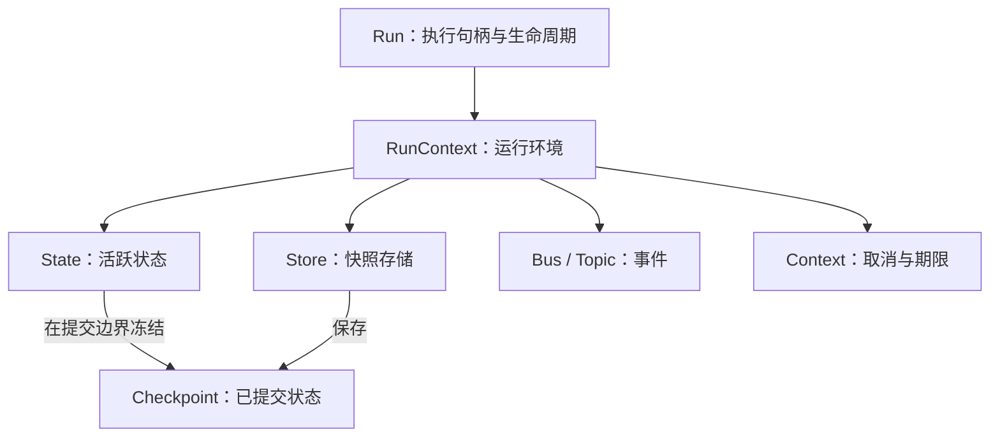

# 会话与执行模型：概念、语义及关系

- 文档类型：项目领域概念设计。
- 日期：2026-10-13。
- 代码参考基线：b28018c。
- 适用范围：goagent 的会话、执行、快照和运行环境。
- 关联设计：[ADR-0032：快照一致性](../adr/ADR-0032-session-snapshot-consistency.md)、[ADR-0033：后台运行与状态](../adr/ADR-0033-background-run-context-and-status.md)、[ADR-0034：会话与任务管理](../adr/ADR-0034-session-task-management.md)。
- 实施计划：[P1 会话与任务管理](../tasks/plan-session-task-management.md)。

本文统一项目中 Session、Thread、Turn、Run、Checkpoint、RunContext 的含义，说明它们的身份、生命周期、数据关系与使用边界。这里的 TurnID 是“交互轮次标识”的正确拼写。

本文同时描述当前代码与拟实施设计。涉及新增 API 或字段时，以 ADR-0034 为准；概念设计不代表对应功能已实现。

## 1. 概念总览

| 概念 | 项目语义 | 回答的问题 | 当前状态 |
| --- | --- | --- | --- |
| Session | 面向调用者的会话操作对象，绑定一个 Agent 和一个 Thread | 通过哪个对象操作这段对话？ | ADR-0034 规划新增 |
| Thread | 持续积累状态、具有独立历史和 head 的对话分支 | 操作属于哪条历史？ | 已有 ThreadID 与存储语义，未要求独立 Thread 类型 |
| ThreadID | Thread 的标识，也是快照存储与线程写入协调使用的键 | 加载、推进哪条历史？ | 已实现 |
| Turn | 一次用户输入引发的逻辑交互，可跨越工具调用、审批暂停与恢复 | 正在处理用户的哪次请求？ | 本文及 ADR-0034 定义的业务概念 |
| TurnID | 将同一交互中的多次执行关联起来的标识 | 暂停前后是否属于同一轮交互？ | ADR-0034 规划新增 |
| Run | 一次具体执行的生命周期；代码中的 *Run 是观察、等待和取消它的进程内句柄 | 这次执行怎么样了？ | 已实现 |
| RunID | 一次具体执行的标识 | 日志、事件和结果属于哪次执行？ | 已实现；普通快照中的统一关联字段规划新增 |
| Checkpoint | 在提交边界冻结保存的状态快照 | 当时执行到哪里，状态是什么？ | 已实现 |
| RunContext | 执行期间使用的运行环境，包含活跃状态、存储、事件总线和取消信号等 | 本次执行使用什么资源、操作什么状态？ | 已实现 |

这些概念分属不同层面：Session 是调用入口；Thread 是历史归属；Turn 是用户交互归属；Run 是执行归属；Checkpoint 是保存的状态；RunContext 是执行环境。

## 2. Session：会话操作入口

### 2.1 定义

按 ADR-0034，Session 是一个绑定 Agent 和 ThreadID 的高层对象，提供 Send、GetHead、History、ForkFrom 等操作，统一承担加载、归属校验和分支保存的编排。

```text
Session = Agent + ThreadID + 会话操作方法
Thread  = 该 ThreadID 对应的历史、状态与 head
```

计划中的 API 示例：

```go
// 拟新增，不能视为当前可编译示例。
session, err := a.OpenSession(ctx, "conversation_001")
```

### 2.2 身份与生命周期

- 一个 Session 对象绑定一个 Thread。
- 多个 Session 对象可以访问同一个 Thread，例如不同客户端连接同一历史，或进程重启后重新打开。
- 销毁 Session 对象不会删除 Thread 的持久化历史。
- OpenSession 不写空 checkpoint，因此打开成功不表示已经存在持久化历史。
- ForkFrom 创建新的 Thread，并返回绑定新 Thread 的 Session。
- Session 不长期缓存可作为提交依据的 head；实际执行仍遵守运行启动时的读取与 owner 协议。

### 2.3 尚未引入的上层会话实体

本批设计没有独立 SessionID，也没有“一个持久化 Session 管理多个 Thread”的聚合模型。

如果未来产品需要一个聊天窗口内管理多个可切换分支，可以另行定义持久化 Session 实体，通过 SessionID 归集多个 ThreadID。该扩展需要独立决策，不能从当前 Session 门面推导出来。

## 3. Thread 与 ThreadID：历史分支及其身份

Thread 是一条持续积累的对话历史，具有自己的已提交状态、head 和 revision 序列。ThreadID 用于定位这条历史，并参与写入协调。

Thread 不是操作系统线程，也不是 goroutine。不同进程可以在不同时刻继续同一个 Thread；同一进程也可以处理多个 Thread。并发写入保证由 store 与协调协议决定，不能仅凭 ThreadID 相同就假设写入自动串行。

当前 ThreadID 还受文件名安全规则约束，见 core.CheckThreadID。路径合法不等于用户有访问权限；ThreadID 不是租户认证凭据。

head 表示 Thread 当前最新的已提交快照。对具有 revision 的内置持久化路径，revision 用于提交顺序与 CAS，而非依赖快照时间决定 head。

## 4. Turn 与 TurnID：一次用户交互

Turn 表示一次用户输入引发的逻辑交互。它可以包含多次模型请求、多次工具调用，以及人工审批导致的暂停和恢复。

例如用户输入“生成发布说明，批准后发布”，从业务视角是一轮交互；等待审批并不把该请求变成另一个用户请求。

ADR-0034 约定：

- 新输入创建新的 TurnID。
- Resume 创建新的 RunID，沿用暂停 checkpoint 的 TurnID。
- 旧暂停记录没有 TurnID 时，在首次恢复时创建新值，不伪造过去的关联。
- Fork 的新分支起点不继承来源 RunID/TurnID，首次 Send 创建新的 TurnID。

Turn 是用户交互概念，不能直接等同于某个循环中的 step、一次模型调用，或 MaxTurns 预算计数。各执行计数的含义以实际 API 为准，不因词语相似而自动改成 TurnID 的语义。

TurnID 用于关联，不单独提供幂等提交、重试去重或恢复授权。后续执行仍要通过 claim、revision 和审批校验。

## 5. Run 与 RunID：一次具体执行

Run 表示一次执行生命周期。当前 *agent.Run 是进程内句柄，提供等待、事件观察、取消、审批与恢复相关操作。

运行句柄可以先创建、后驱动。拿到 *Run 不等于模型和工具已经开始执行。它也不等于一个专属 goroutine；实际执行由既有惰性驱动机制决定。

一次 Run 可以包含多个模型/工具步骤，也可以调用子 Agent。子 Agent 调用不必然创建新的 RunID：当前 RunContext 的派生路径会沿用父运行的 RunID 和 ThreadID。

在 ADR-0034 的交互模型中：

```text
一个 Turn → 一个或多个 Run
一个 Run  → 归属于一个 Turn
```

典型审批流程：

```text
Turn turn_01：生成发布说明，并在批准后发布
│
├─ Run run_01
│  ├─ 调用模型，生成发布说明
│  └─ 保存暂停快照，结束本次执行，等待批准
│
└─ Run run_02
   ├─ 批准后 Resume
   ├─ 继续被暂停的工作
   └─ 完成
```

RunID 标识执行，TurnID 标识跨执行的交互，ThreadID 标识它们积累状态的历史分支。三者不能互相替代。

## 6. Checkpoint：提交边界上的冻结状态

### 6.1 状态与过程

Run 是过程，Checkpoint 是保存下来的状态。一个 Run 可以有零个或多个成功提交的 Checkpoint。

```text
Run run_01
  ├─ 保存 checkpoint_01
  ├─ 保存 checkpoint_02
  └─ 保存 checkpoint_03
```

准备阶段失败或第一次提交失败时，该 Run 可以没有任何自己的已提交快照。不能把它启动时继承的旧 head 当作本次执行已经成功提交的结果。

Checkpoint 不必对应一次模型调用。Fork 可以创建分支起点，RecordCompletion 可以追加运行结局快照，应用也可以通过底层接口保存状态。因此“每个 Checkpoint 都是一次模型回复”不成立。

### 6.2 身份、顺序与谱系

| 属性 | 语义 | 不承担的职责 |
| --- | --- | --- |
| CheckpointID | 标识一个快照 | 不表示执行身份或提交顺序 |
| ThreadID | 标识快照所在分支 | 不表示租户授权 |
| Revision | 线程内提交版本，用于排序和 CAS | 不是业务 schema 版本，也不是 RunRecord 版本 |
| ParentID | 当前已有的父快照 ID | 单独使用不能完整定位跨线程父快照 |
| ParentRef | 拟新增的 {ThreadID, CheckpointID}，定位父快照 | 不代表任务调度依赖 |
| RunID / TurnID | 拟新增的执行与交互关联字段 | 不改变 head 排序规则 |
| CreatedAt | 拟新增的首次构造时间 | 不取代 revision 决定 head |

当前 Load 需要同时给出 ThreadID 与 CheckpointID。因此跨线程谱系必须保存完整引用。旧记录无法确定父线程时，应保留未知，不从同名 ID 或当前线程猜测来源。

### 6.3 head 不等于实时运行状态

假设上一轮留下了完成快照，新 Run 已启动但尚未提交，Thread 的 head 仍然是上一轮的完成记录。

因此，head 可以回答“最后提交到哪里”，不能独自回答“现在有没有 Run 正在执行”。当前 Agent.RunStatus 读取的是线程 head；计划中的 GetRun 才用于读取特定 RunID 的任务记录。

### 6.4 冻结范围

Checkpoint 保存冻结后的状态视图。消息、可克隆业务状态和可快照文件遵守既有隔离规则。外部托管的目录或远端文件后端不因存在 Checkpoint 就自动可回滚，恢复时仍可能需要调用方重新注入。

## 7. RunContext：运行期间的环境

当前 RunContext 的主要公开字段如下，内部还包含提交协调、恢复和动态工具等信息：

```go
type RunContext struct {
    context.Context

    RunID    string
    ThreadID string
    Bus      *bus.Bus
    Topic    bus.Topic
    Store    checkpoint.Checkpointer
    State    *core.State
}
```

它把执行需要的资源放在一起：State 是正在变化的消息与业务状态，Store 负责快照，Bus/Topic 负责事件，context.Context 提供取消、期限与上下文值。



RunContext 不作为整体持久化。总线、锁、取消信号和活跃工具不属于历史快照。进程重启后读取 Checkpoint，再结合 Agent 配置和外部资源构造新的运行环境。

一个 Run 可以派生多个 RunContext。当前实现中的差别为：

| 派生方式 | State 关系 | 身份关系 |
| --- | --- | --- |
| deeper | 共享活跃 State，增加委派深度 | 沿用 RunID、ThreadID |
| subRun | 创建局部 State；Files 按当前实现共享 | 沿用 RunID、ThreadID |
| forBranch | 克隆 State，提供并行隔离 | 沿用 RunID、ThreadID |

这些内部派生环境不意味着创建新的持久化 Thread。特别是 forBranch 的并行执行分支，与 checkpoint.Fork 的历史分支必须区分。

## 8. 完整关系示例

### 8.1 一条 Thread 中的交互与执行

下图表示拟实施模型下的业务归属；当前普通快照尚不能据此假设全部已有 RunID/TurnID 字段。

```text
Session 对象
  │ 绑定
  ▼
Thread thread_A
  │
  ├─ Turn turn_01：「介绍一下这个项目」
  │    └─ Run run_01
  │         └─ Checkpoint A1
  │
  ├─ Turn turn_02：「修改配置，提交前让我批准」
  │    ├─ Run run_02
  │    │    ├─ Checkpoint A2
  │    │    └─ Checkpoint A3：暂停
  │    │
  │    └─ Run run_03：批准后恢复
  │         └─ Checkpoint A4：完成 ← thread_A 的 head
  │
  └─ 后续新的 Turn……
```

图中的“完成”表示示例已保存的完成边界，不表示默认每次前台运行都自动调用 RecordCompletion。显式终态记录仍遵守 ADR-0033。

### 8.2 Fork 形成跨线程谱系

```text
thread_A:  A1 → A2 → A3 → A4
                    │
                    │ ForkFrom(A3)
                    ▼
thread_B:           B1 → B2
                         ↑
                    thread_B 的 head
```

B1 的拟新增 ParentRef 指向 {ThreadID: thread_A, CheckpointID: A3}。两个 Thread 各有自己的 head 和 revision；B 的后续提交不移动 A 的 head。

图中的箭头表示“历史延续到下一快照”；实际 ParentRef 存储在子快照中，反向引用父快照。Fork 不会重新执行来源工具，也不复制来源任务的运行状态。

### 8.3 关系的基数与限制

| 关系 | 约定 |
| --- | --- |
| Session → Thread | 一个 Session 对象绑定一个 Thread；多个对象可以绑定同一 Thread |
| Thread → Turn | 一条历史可以包含多轮交互 |
| Turn → Run | 一轮交互可以分为一次或多次执行 |
| Run → Checkpoint | 一次执行可以成功提交零个或多个快照 |
| Thread → Checkpoint | 一个快照属于一个 Thread；父引用可以跨 Thread |
| Thread → head | 没有提交时无 head；有提交时有一个当前 head |
| Run → RunContext | 一次执行有运行环境，也可能派生多个子环境 |

这些关系没有要求新增对应的数据库表。尤其 Session 和 Turn 在本批分别是操作门面与关联语义，不应据此擅自新增持久化聚合实体。

## 9. Run、RunRecord 与队列任务的补充边界

ADR-0034 拟新增的 RunRecord 用于持久化特定 RunID 的排队、运行、暂停、成功、失败、取消等记录。它与另外两个对象职责不同：

| 对象 | 主要职责 | 跨进程边界 |
| --- | --- | --- |
| *agent.Run | 驱动和观察当前执行 | 进程内对象，不能直接反序列化重连 |
| RunRecord | 保存执行身份、状态及关联结果 | 通过存储按 RunID 重新读取；当前为规划能力 |
| queue Job / JobID | 标识队列投递任务 | 依赖队列后端与 payload 协议 |

JobID、RunID 和 ThreadID 不应使用同一字段混装。重复投递同一个执行任务不意味着创建新的逻辑运行。

可重连查询不等于自动恢复执行。进程退出后能够读到 running 或 stale 记录，也不代表可以安全重放已开始的外部工具。是否恢复仍取决于快照、审批、claim/fencing 和 unknown outcome 规则。

## 10. 设计与命名约束

1. 对外参数名按真实语义使用 threadID、runID、turnID、checkpointID，避免统称 sessionID。
2. 讨论“分支”时明确是持久化 Thread 分叉，还是共享 ThreadID 的内部并行执行分支。
3. 查询线程历史用 ThreadID；查询特定执行用 RunID；聚合同一请求的暂停与恢复用 TurnID。
4. Snapshot/Checkpoint 描述已提交状态，RunContext/State 描述活跃环境与数据；不能把活跃指针当不可变历史。
5. 时间、提交 revision、任务记录 Version 和业务 schema version 各自独立，不能互相替代。
6. 新增类型与 API 的可用性以实现为准；本文中的概念关系不构成已经交付的声明。

## 11. 源码与设计索引

- [agent/runtime.go](../../agent/runtime.go)：RunContext 及派生环境。
- [agent/run.go](../../agent/run.go)：运行句柄、驱动与冻结结局。
- [agent/agent.go](../../agent/agent.go)：Run/Stream、ThreadID 配置和状态还原。
- [agent/hitl.go](../../agent/hitl.go)：审批与恢复执行。
- [agent/durable_runtime.go](../../agent/durable_runtime.go)：本次运行的成功提交边界。
- [agent/run_status.go](../../agent/run_status.go)：线程 head 查询的含义与限制。
- [checkpoint/checkpoint.go](../../checkpoint/checkpoint.go)：快照、终态与存储接口。
- [checkpoint/branch.go](../../checkpoint/branch.go)：Fork 的冻结和分支语义。
- [queue/agent_bridge.go](../../queue/agent_bridge.go)：进程内后台句柄与记录终点。
- [ADR-0034](../adr/ADR-0034-session-task-management.md)：Session、TurnID、RunRecord 和新查询能力的拟定契约。
