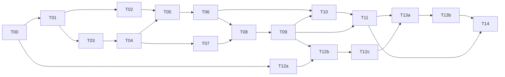

# Lazy Run Lifecycle Implementation Plan

> **For agentic workers:** REQUIRED SUB-SKILL: Use superpowers:subagent-driven-development (recommended) or superpowers:executing-plans to implement this plan task-by-task. Steps use checkbox (`- [ ]`) syntax for tracking.

**Goal:** 保留普通 Stream 的惰性行为，修复总线取消互锁、终态阻塞和迟到订阅、队列启动权问题，并统一 Run 的等待、结算与取消契约。

**Architecture:** Bus 负责可取消的普通发送与有限终态尾部交付；Run 的唯一结算者负责冻结结果、释放 claim/gate 和关闭 done。观察者不决定运行结局，queue worker 独占队列任务启动权，完整构造后才激活父 context 取消关联。

**Tech Stack:** Go（go.mod 下限 1.25.0）、context、sync、iter、现有 checkpoint/queue、现有 OpenTelemetry API 与测试 SDK；不增加第三方依赖。

---

## 1. 依据、范围与执行约束

- 日期：2026-10-28；计划状态：Implementing；执行分支 `fix/lazy-run-lifecycle-7Ps`（用户指定）。
- 唯一实施规格：[惰性 Run 生命周期设计](../specs/2026-10-28-lazy-run-lifecycle-design.md)。计划基线 HEAD：`5e7b603`；执行前重新核验。相对路径均相对于仓库根目录 `D:\codeproject\mygo\goagent`。
- 本次交付是实施计划；下列新接口、新测试和验收结论均为待执行项。设计阶段通过的既有测试只算旧实现基线。
- 当前有预先存在的未跟踪文档及 `.scratch/`。执行时逐文件暂存，不使用 `git add .`，不清理或覆盖这些内容；按用户要求使用 `fix/lazy-run-lifecycle-7Ps` 分支，`.scratch/` 不提交。
- 不改变输入在创建时冻结、历史在获得 admission 后恢复的时点；不增加全历史回放、Handle.Start、公开 Done/Result/WaitContext 或实时 RunStatus API。
- 保留普通 Lossless 背压。只有根 TaskDone 与 RunDone/RunFailed/Interrupted 尾部交付不阻塞运行结算；workflow/plan 的子 TaskDone 仍走可取消的普通发送。
- 外部模型、工具、hook 或 store 必须协作响应 context；本计划不承诺强制抢占忽略 context 的外部代码。
- 每项按“建立失败测试 → 最小实现 → 定向通过 → 提交候选”执行。小步骤以单个测试、函数或调用点为单位；协议相连的任务在里程碑一起验收。不得为完成任务而临时跳过旧回归。
- 文中的生产代码块规定核心签名或算法，不是完整补丁；测试矩阵规定必须建立的用例及屏障位置。执行者须在所列文件中补齐实现和测试，保持编译后再推进。

## 2. 优先级、任务与依赖

| 规格项 | 主任务 | 后置联合验收 | 交付条件 |
| --- | --- | --- | --- |
| P0-1 发布/退订互锁 | T01、T03 | T02、T11 | 可取消发送与 send/close 协议均通过竞态测试 |
| P0-2 终态/迟到订阅 | T02、T04、T05 | T11 | 慢观察者不阻塞根终态结算，晚订阅有限结束 |
| P0-3 队列执行权 | T06、T10 | T08、T09、T11 | Wait 不启动；已取消但未结算时不记录；未启动取消可等待 |
| P1-1 Start/Await 契约 | T06 | T08、T09 | Start 幂等，Await 纯等待，等待 context 不取消执行 |
| P1-2 单一结算/结果隔离 | T04、T05、T06 | T11 | 无 capture 结算；Wait 无订阅；结果/事件/hook 副本隔离 |
| P1-3 状态机/构造激活 | T07、T08、T09 | T11 | 唯一结算者；Prepared Cancel 清理；所有工厂最后激活 |
| P2-1 文档/兼容/观测 | T12a、T12b、T12c、T13a、T13b | T14 | 指标时点、示例、ADR 与变更说明一致 |

| 任务 | 依赖 | 建议规模 | 完成后的可验证增量 |
| --- | --- | --- | --- |
| T00 基线与测试设施核验 | 无 | XS | 基线、工具链、竞态环境可追溯 |
| T01 可取消的普通发送 | T00 | M | 满缓冲能取消，其他 topic 索引操作不受阻 |
| T02 订阅终态收尾协议 | T01 | M | FinishTopic 快速返回，尾部最终可靠交付 |
| T03 框架发送迁移 | T01 | M | 框架普通发送可被运行 context 中断 |
| T04 执行方结算与冻结 | T03 | M/L，单一协议 | claim→gate、冻结→hook，观察者不再结算 |
| T05 Run 观察封闭 | T02、T04 | M | 根尾部不阻塞 done；迟到订阅得到有限尾部 |
| T06 Start/Await/Wait | T05 | M | 启动/等待分离，等待者不订阅 |
| T07 有期限的独立清理 | T04 | M | 无 guard 的 claim 释放也有期限 |
| T08 生命周期状态机 | T06、T07 | M | 显式 Prepared Cancel 完整内存结算 |
| T09 完整构造后激活 | T08 | M | 父取消安全结算所有工厂产生的 Run |
| T10 队列 worker 启动权 | T06、T09 | M | 队列等待无法绕过 worker 并发上限 |
| T11 跨层对抗回归 | T10、T09 | M | P0/P1 的联合验收完成 |
| T12a 观测记录器 | T00 | S | 既有 OTel API 上记录时点与耗时 |
| T12b 运行观测接入 | T09、T12a | M | 创建、启动请求和结算与唯一 owner 一致 |
| T12c 准入及首响应接入 | T12b | M | 普通/Resume 准入与首响应时点真实 |
| T13a API 文档与 ADR | T11、T12c | S | 公共方法、迁移决策及发布说明准确 |
| T13b README 与示例 | T13a | M | 使用者可按示例正确启动/观察/等待 |
| T14 完整验证与审核 | T11、T12c、T13b | S | 最终 DoD 与证据齐全 |



关键路径为 T00→T01→T03→T04→T05→T06→T08→T09→T10→T11；T02、T07 必须在汇合前完成。队列改动 T10 在 T09 后合并，避免纯 Await 接入后未消费任务取消仍无法结束 Wait。

允许并行：T02 与 T03 写集独立；T12a 与主线独立；T10 与 T07 写集独立，但合并受 T09 前置条件约束。T04～T06、T08/T09 共享 Run，必须串行；T12b/T12c 不与它们同时改动。T11 回归矩阵可分包执行，仍需最终跨包 race。文档可预写，行为定稿后统一校准。是否启用子代理由实施方式决定，计划编制仅委托只读独立审核，不启动生产开发代理。

## 3. 文件职责与改动落点

下表“新增”表示计划创建，其余路径已核验存在。除按职责拆分 Run 和订阅外，不做无关重排。

| 路径 | 操作 | 职责/任务 |
| --- | --- | --- |
| `bus/bus.go` | 修改 | 索引快照、PublishContext、FinishTopic；T01/T02 |
| `bus/subscription.go` | 新增 | 单订阅状态、发送登记、取消与尾部收尾者；T01/T02 |
| `bus/terminal_tail.go` | 新增 | 规范化终态尾部的每订阅数据副本；T02 |
| `bus/subscription_internal_test.go` | 新增 | 直接控制登记/封闭/退出屏障；T01/T02 |
| `bus/bus_test.go` | 修改 | 保留顺序/Lossy/Adapt 回归；T01/T02 |
| `agent/run.go` | 修改 | Run 字段、公开观察/等待方法、执行入口；T03～T06/T08 |
| `agent/run_outcome.go` | 新增 | 统一结算管线、结果和 hook 副本、终态尾部构建；T04 |
| `agent/run_observation.go` | 新增 | observationMu、subscribeRun、sealEvents、迟到尾部；T05 |
| `agent/run_lifecycle.go` | 新增 | phase、Start/Cancel 竞争、父取消激活握手；T08/T09 |
| `agent/run_cleanup.go` | 新增 | 有期限的清理 context 构造；T07 |
| `agent/run_outcome_internal_test.go` | 新增 | 冻结失败、hook 参数、prepare 清理顺序；T04 |
| `agent/run_observation_internal_test.go` | 新增 | 晚订阅、尾部隔离、订阅/封闭竞争；T05 |
| `agent/run_wait_internal_test.go` | 新增 | Start/Await、无额外订阅、等待副本；T06 |
| `agent/run_lifecycle_internal_test.go` | 新增 | 阶段竞争、Prepared Cancel、激活回调；T08/T09 |
| `agent/run_cleanup_internal_test.go` | 新增 | 有/无 guard 清理期限与续租退出；T07 |
| `agent/run_integration_internal_test.go` | 新增 | 子 TaskDone 背压、跨层竞争；T11 |
| `agent/runtime.go` | 修改 | RunContext.publish 使用执行 context；T03 |
| `agent/run_prepare.go` | 修改 | 去掉准备失败提前交接 gate；T04 |
| `agent/agent.go` | 修改 | newRunHandle、finishRun 参数隔离、streamConfigured 最后激活；T04/T09 |
| `agent/result.go` | 修改 | DetailedResult 的副本出口；T06 |
| `agent/approval_event.go` | 修改 | durable receipt 优先、通知可取消且不重开事件流；T03/T05 |
| `agent/managed_run.go`、`agent/hitl.go` | 修改 | Resume 构造失败有界清理（T07）；所有返回句柄的分支最后激活（T09） |
| `agent/durable_runtime.go`、`agent/write_guard.go` | 修改 | guard/无 guard 清理使用统一期限；T07 |
| `agent/workflow.go`、`agent/plan.go` | 核验，必要时修改 | 子 TaskDone 保持普通可取消发送，不封闭 topic；T03/T11 |
| `agent/terminal.go` | 回归核验 | 保留提交边界/RecordCompletion 约束；不另造持久化路径 |
| `queue/agent_bridge.go` | 修改 | Handle.Wait 纯 Await、worker Start→Await→记录、私有绑定记录入口；T10 |
| `queue/agent_bridge_test.go` | 修改 | terminalEvent 持续接收、旧取消和上下文回归；T05/T10 |
| `queue/agent_terminal_test.go` | 修改 | 等真正结算才记录、缺少本次边界；T10/T11 |
| `queue/agent_ownership_test.go` | 新增 | 无 worker/并发上限/取消前后执行权；T10/T11 |
| `internal/runobs/timing.go`、`internal/runobs/timing_test.go` | 新增 | OTel API 的内部时间记录器；T12a |
| `agent/admission.go`、`agent/hitl.go`、`agent/loop.go` | 修改 | 真实准入、首次有效模型响应标记；T12c |
| `agent/run_observability_internal_test.go` | 新增 | 时点与生命周期/Resume 对齐；T12b/T12c |
| `obs/otel/otel_test.go` | 既有回归 | 模型/工具 span 树、错误和无 provider 行为 |
| `README.md`、`README-en.md` | 修改 | 流式和后台用法；T13b |
| `examples/quickstart-stream/main.go`、`examples/background/main.go` | 修改 | 订阅退出/worker 先启动；T13b |
| `examples/lazy-run-lifecycle/main.go` | 新增 | 使用 mock 的可离线运行契约示例；T13b |
| `docs/adr/ADR-0033-background-run-context-and-status.md` | 修改 | D5 添加日期和替代决策链接；T13a |
| `docs/adr/ADR-0035-lazy-run-lifecycle-and-queue-start.md` | 新增 | 保留 ADR-0034 编号，记录执行权与观察语义决策；T13a |
| `docs/changes/2026-10-28-lazy-run-lifecycle.md` | 新增 | 明确行为变化和迁移步骤；T13a |

## 4. 核心接口与同步契约

只增加以下公共接口，既有方法签名保留：

```go
func (b *Bus) PublishContext(ctx context.Context, topic Topic, ev core.Event) error
func (b *Bus) FinishTopic(topic Topic, tail ...core.Event)
func (r *Run) Start()
func (r *Run) Await(ctx context.Context) (core.Result, error)
```

| 内部符号 | 文件/任务 | 精确职责 |
| --- | --- | --- |
| `subscriber.beginSend() bool`、`subscriber.endSend()` | subscription.go/T01 | 同锁 active 检查与 normalWG.Add；登记发送结束 |
| `subscriber.send(context.Context, core.Event) error` | subscription.go/T01 | 调用 begin/end；执行 Lossless/Lossy 可取消发送 |
| `subscriber.seal([]core.Event)` | subscription.go/T02 | 同锁安装 tailDone，锁外启动唯一尾部收尾者 |
| `Run.settleExecution(runOutcome, bool, bool)` | run_outcome.go/T04 | 参数依次为执行结局、rootStarted、hooksEligible；唯一结算者使用 |
| `cloneResult(core.Result) (core.Result, error)` | run_outcome.go/T04 | 完整深拷贝，不在失败时返回原始可变值 |
| `Run.subscribeRun(bus.DeliveryMode) (<-chan core.Event, func())` | run_observation.go/T05 | 在 observationMu 下选择普通订阅或有限尾部 |
| `Run.sealEvents([]core.Event)` | run_observation.go/T05 | 缓存独立尾部并 FinishTopic；不等待消费 |
| `Handle.recordCompletion func(context.Context, *agent.Run) error` | agent_bridge.go/T10 | 绑定 owner 的私有记录函数；可在 worker 启动前包计数器 |
| `Run.settledCopy() (core.Result, error)` | run_outcome.go/T06 | 读取 FrozenOutcome 的独立副本；Await 的统一返回出口 |
| `Run.activateLifecycle()` | run_lifecycle.go/T09 | 同锁登记 AfterFunc、发布 stop 与 activated 标记 |
| `newRunCleanupContext(context.Context) (context.Context, context.CancelFunc)` | run_cleanup.go/T07 | 保留 values、解除执行取消、设定有界清理期限 |
| `runobs.New(context.Context, string, string) *Recorder` | timing.go/T12a | 参数为 context、runID、threadID；记录创建时间 |
| `Recorder.StartRequested()`、`Admitted(time.Time)`、`FirstModelResponse()`、`Settled()` | timing.go/T12a | 各时点幂等写入，只有已出现阶段才产生对应间隔 |

同步规则：Bus.mu 不与订阅锁嵌套；生命周期锁、观察锁、terminalMu 不跨 I/O 或用户 hook。normalWG 只计普通发送，tailDone 只表示尾部发送者退出。done 表示 Run 结算，queue.Handle.settle 表示 worker 的记录尝试结束，两者不能替换。

## 5. 任务明细

### T00：确认基线、边界与竞态执行环境

**依赖：** 无。**代码改动：** 无。**交付：** 执行记录写在本计划末尾的证据表。

- [x] 核验 `git status --short`、`git rev-parse HEAD`、`go version`、`go env GOOS GOARCH CGO_ENABLED CC`，记录预先存在的修改和未跟踪文件。
- [x] 执行 `go test ./bus ./agent ./queue -count=1 -timeout=90s`；预期三个包通过。若现有基线失败，先定位并记录，不能把失败归到新协议。
- [x] 执行 `go test -race ./bus -count=1 -timeout=90s`；预期通过。Windows 缺可用 C 工具链时，配置支持 race 的 Windows 环境或使用受支持的 Linux runner；不能把普通 test 当作 race 等价证明。
- [x] 核验 `bus/bus.go`、`agent/run.go`、`agent/run_prepare.go`、`agent/hitl.go`、`queue/agent_bridge.go` 与设计一致；若 HEAD 改变，先更新落点和依赖。
- [x] 新增测试使用 package 内部测试访问私有同步点；默认用 `testing/synctest`、已有 store spy 或 channel 屏障。不增加公开调试 API。

**DoD：** 基线和竞态环境证据完整；后续实施只暂存明确列出的路径；当前最低 Go 版本可编译所用测试设施。

### T01：实现可取消、退订安全的普通发送

**依赖：** T00。**文件：** 修改 `bus/bus.go`、`bus/bus_test.go`；新增 `bus/subscription.go`、`bus/subscription_internal_test.go`。

- [x] 先新增 `TestPublishContextCancelledWhenFull`、`TestUnsubscribeUnblocksRegisteredPublish`、`TestSlowTopicDoesNotBlockOtherTopic`，保留 FanOutOrdered/LossyDropsWhenFull。
- [x] 用容量 1 的订阅填满缓冲；在同包测试中取得该订阅，先调用 beginSend 精确固定“发送已登记”，再并发退订。不要用延时猜测发送者是否已经进入 select。
- [x] 运行失败测试：`go test ./bus -run 'Test(PublishContextCancelledWhenFull|UnsubscribeUnblocksRegisteredPublish|SlowTopicDoesNotBlockOtherTopic)$' -count=1 -timeout=30s`。预期新接口不存在或旧实现不能满足取消用例；只针对目标缺口解释失败。
- [x] 将订阅的关闭权与发送登记放入 subscription.go。最小核心如下；sendStop 的关闭也必须在此锁下受状态转换保护。

```go
func (s *subscriber) beginSend() bool {
    s.mu.Lock()
    defer s.mu.Unlock()
    if s.phase != subscriptionActive {
        return false
    }
    s.normalWG.Add(1)
    return true
}

func (s *subscriber) endSend() { s.normalWG.Done() }
```

新增私有 `subscriptionPhase` 与 `subscriptionActive/subscriptionSealing/subscriptionCanceling/subscriptionClosed`。字段至少包括 mu、phase、ch、mode、normalWG、sendStop、cancelSignal、closed，以及 T02 使用的 tailDone。退订是 active→canceling 或 sealing→canceling；后者不能再次关闭 sendStop。

- [x] PublishContext 在 Bus.mu 下复制 `[]*subscriber` 后释放锁，逐订阅调用 send；开始时检查 ctx.Err，Lossless 的 select 同时等待 ch、ctx.Done、sendStop。Lossy 在相同登记协议下尝试发送/取消/default，满缓冲丢普通事件。某订阅已退订/封闭直接跳过，不成为运行错误。
- [x] 退订先在订阅锁内禁止登记并发出取消信号，锁外删除总线索引，再在锁外等待 normalWG；无尾部发送者时由退订路径关闭数据 channel 和 closed。并发退订调用都等待 closed 后返回。不能持有 Bus.mu 等待，不能用 recover 隐藏关闭竞争。
- [x] 保留 `Publish(topic, ev)`，实现为调用 PublishContext(Background, topic, ev) 的兼容包装。说明部分 fan-out 后可返回 ctx.Err，调用方不能据此无条件重试。
- [x] 执行上面的定向命令及 `go test -race ./bus -count=10 -timeout=120s`；预期通过，无 race/panic。
- [x] 生成提交候选：`fix(bus): make publish and unsubscribe cancellation safe`。

**DoD：** 已登记发送不会与 close 并发；退订返回意味着发送结束且数据 channel 已关闭；满缓冲取消/跨 topic 操作通过；Lossy 和串行发布顺序不变。

### T02：实现 FinishTopic 和唯一尾部收尾者

**依赖：** T01。**文件：** 修改 `bus/bus.go`、`bus/subscription.go`、`bus/subscription_internal_test.go`；新增 `bus/terminal_tail.go`。

- [x] 新增 `TestFinishTopicReturnsWithFullBuffer`、`TestFinishTopicPreservesQueuedOrder`、`TestFinishTopicLossyStillDeliversTail`、`TestFinishTopicCancelJoinsTailSender`、`TestFinishTopicCancelRegisteredSendRace`、`TestFinishTopicDoesNotKeepTombstone`、`TestFinishTopicTailCopiesAreIndependent`。
- [x] 用 beginSend 固定一条在途普通发送，再让 FinishTopic 和退订竞争；分别强制 cancel 先获锁与 seal 先获锁。所有已登记发送、tailDone、closed 都必须最终退出。自然收尾、提前取消、重复调用三组分别覆盖。
- [x] 运行 `go test ./bus -run '^TestFinishTopic' -count=1 -timeout=30s`，先确认新接口/新契约导致失败，再实现下列顺序。

```text
Bus.mu: 摘除当前 topic 的订阅集合 → 解锁
每订阅 mu: active→sealing；close(sendStop)；安装 tailDone → 解锁
启动一个收尾 goroutine：normalWG.Wait → 按序发送尾部/监听 cancelSignal
收尾 goroutine：close(ch) → close(closed) → close(tailDone)
```

- [x] seal 在订阅锁内先发布 tailDone，再在锁外启动 goroutine；cancel 看见已安装 tailDone 时只能唤醒并等待它，不得自己 close(ch)。cancel 先获胜则 seal 不启动收尾者。重复 FinishTopic 不能重新获取已摘除订阅。
- [x] tail 只占固定 1～2 个事件的 Run 尾部空间。terminal_tail.go 对框架已经规范化的 RunDone 消息、Interrupted.Pending 的切片及嵌套可变内容做每订阅副本；Run 缓存、不同订阅、FrozenOutcome 之间不能共享可变 payload。error 对象按现有只读约定传递，不尝试复制任意自定义 error。
- [x] 所有可失败的框架消息规范化在 T04 冻结前完成。Bus 的尾部复制仅复制已验证的 core 数据变体，不新做会改变结局的序列化或业务校验；禁止克隆失败后回退共享原始消息。普通事件仍按既有只读契约，未承诺每次 Publish 深拷贝。
- [x] 验证 FinishTopic 不等待 normalWG 或 channel 消费，Bus 不存结束 topic 的 tombstone；generic Subscribe 在其后仍是新订阅，不具回放能力。
- [x] 执行 `go test -race ./bus -run 'Test(FinishTopic|Unsubscribe|PublishContext)' -count=30 -timeout=180s` 及 `go test ./bus -count=1 -timeout=60s`。
- [x] 生成提交候选：`feat(bus): seal subscriptions with ordered terminal tails`。

**DoD：** 尾部收尾者最多每订阅一个；Lossy 的尾部也可靠；退订能唤醒并等待收尾者；正常排空后自动关闭 channel；三方竞争无 race/双重 close；FinishTopic 返回不依赖消费者。

### T03：把框架普通事件迁移到可取消发布

**依赖：** T01。**文件：** 修改 `agent/runtime.go`、`agent/run.go`、`agent/approval_event.go`；在 `agent/run_integration_internal_test.go` 新增本任务用例。核验 workflow.go、plan.go 及所有直接发布点。

- [x] 新增 `TestFrameworkPublishCancelledWhenFull`，分别覆盖 RunStarted、TaskStarted 和 RunContext.publish；执行入口普通事件统一走 rc.publish；在隔离测试中用三种事件填满缓冲后取消执行 context，确认这一次普通发布调用退出。T03 不以“根运行在满缓冲、无人消费时 done 关闭”为验收条件；该条件依赖 T05。
- [x] 新增 `TestApprovalReceiptSurvivesObserverCancellation`：先阻塞通知再取消通知 context，durable receipt 仍可从 store 查询；不能因为观测失败重写或否认已提交的审批。
- [x] 执行 `go test ./agent -run 'Test(FrameworkPublish|ApprovalReceipt)' -count=1 -timeout=30s` 观察缺口。
- [x] RunContext.publish 保持现有无返回值的内部签名，使用 `rc.Bus.PublishContext(rc.Context, rc.Topic, ev)`；退出由执行 context 和既有循环取消检查传播，不凭观察者退订创建运行错误。执行入口的 RunStarted、TaskStarted 等普通发布点同样使用运行 context；根 TaskDone 与 RunDone/RunFailed/Interrupted 在 T03/T04 暂保留原 Bus.Publish，确保已取消运行仍能向旧 Iter 交付终态；T05 再一次性换成 sealEvents/FinishTopic。
- [x] RecordApproval 的通知用调用方 ctx 发布；持久化成功是权威结果，忽略单纯通知交付失败，T05 再加入 Run 已封闭检查。不可把调用方 context 替换为 Background 重新无限等待。
- [x] 检索 `rg -n '\.Publish\(' agent`：在 T03/T04 只允许根 TaskDone 与 Run 终态继续使用兼容 Publish，并写明临时原因；T05 后这些调用全部迁移到 FinishTopic。子任务 TaskDone 始终不迁移到 FinishTopic。
- [x] 执行 `go test ./agent ./queue -count=1 -timeout=120s`；预期既有失败/取消/并行 workflow 回归继续通过。
- [x] 生成提交候选：`fix(agent): cancel blocked framework event publishing`。

**DoD：** 框架运行 context 能打断普通事件背压；根尾部的旧交付方式仅保留到 T05，禁止提前改成已取消 context 的 PublishContext；派生 RunContext 沿用正确执行取消；审批 receipt 与观察交付脱钩；尚未宣称满缓冲根终态和 Prepared Cancel 验收完成。

**里程碑 M1：** T01～T03 完成后，`go test -race ./bus ./agent -count=1 -timeout=180s` 通过；发送/取消/关闭协议可独立审阅。T04/T05 的联合结果仍待交付。

### T04：将准备、执行和清理收敛到唯一结算者

**依赖：** T03。**文件：** 修改 `agent/run.go`、`agent/agent.go`、`agent/run_prepare.go`；新增 `agent/run_outcome.go`、`agent/run_outcome_internal_test.go`。

- [x] 新增下列测试；用 channel 控制 store 和 hook，不以 sleep 推断先后：
  - `TestPrepareFailureReleasesClaimBeforeAdmission`：A 已获 gate/claim，prepare 失败且 claim release 被屏障挡住；B 的 BeginRun 计数保持 0，放行 A 的释放尝试后 B 才能进入。
  - `TestFreezeFailurePrecedesFinishRun`：构造 `core.CloneMessage` 必定失败的合法测试消息，最终 hook/Wait/FrozenOutcome/终态均报告失败；T06 后补验 Await，hook 不得先收到成功。
  - `TestFinishRunMutationDoesNotChangeOutcome`：hook 改写结果消息与可变片段，FrozenOutcome、DetailedResult、RunDone 与 RecordCompletion 仍是相同冻结值。
  - `TestPrepareFailurePreservesHookEligibility`、`TestPausedRunSkipsFinishRun`：准备失败不新增旧代码没有的 hook；无错误暂停不调用 FinishRun。
- [x] 修改 prepare：删除“prepare 任意错误时 defer 先 releaseAdmission”的路径。只有真正取得 gate 才交 Run 结算权；prepare 错误也由结算者先尝试释放 durable claim/guard，再释放 gate。未取得 gate 时不释放。
- [x] 统一所有成功、startErr、prepare 错误、执行错误、取消/暂停路径进入 `settleExecution(out, rootStarted, hooksEligible)`。它是唯一的结果写入者和 done 关闭者；彻底移除 `capture`、`finish`、`doneOnce` 等观察者结算路径。
- [x] 顺序固定：关闭 steering → 在仍持有 claim 时捕获 checkpoint boundary → 停止/释放 guard 与 claim（T07 补齐全部路径的有界性） → 释放 gate → 合并 cleanup 错误 → 完成结果规范化、hook 参数副本和终态尾部 payload 副本准备 → 冻结结果/身份/boundary → 用独立副本调用既有 eligible hooks → 取出已准备的尾部 → T05 封闭观察 → T09 取出 AfterFunc stop 并在锁外 stop/release context → T08 发布 Settled 与关闭 done。本任务先保留现有 Bus.Publish 根尾部交付和 done 结束入口；不得使用已取消的执行 context 发布终态，T05 替换为 sealEvents；最终协议在 M2 联合验收，不提前引用尚未新增的函数/字段。
- [x] `cloneResult` 失败必须改成零结果失败 outcome，再冻结并交给 hook；不返回/保存原对象。hook 不改变结局且不逐个 hook 重新判错。FrozenOutcome、DetailedResult、T06 的 Await 和队列记录读取一致冻结 outcome。FrozenOutcome/Await 有 error 出口，二次 Clone 失败返回明确错误且绝不共享；DetailedResult 不改签名，只从已验证规范数据复制，防御性复制失败时返回零 Result，不能回退共享原值。
- [x] 对 `rootStarted=false` 的尾部只构造 `RunFailed`，不伪造 TaskDone；`rootStarted=true` 尾部为根 TaskDone + 且仅一个 RunDone/RunFailed/Interrupted。未启动取消（T08）不发 RunStarted。workflow/plan child TaskDone 不在此处封闭。
- [x] `RunContext.releaseDurableClaim` 的所有错误进入冻结失败结局；若 guard 释放失败保留原 fencing/retry 行为，先记录错误再释放 gate，不谎称资源释放成功。
- [x] 执行 `go test ./agent -run 'Test(PrepareFailureReleasesClaimBeforeAdmission|FreezeFailurePrecedesFinishRun|FinishRunMutationDoesNotChangeOutcome|PrepareFailurePreservesHookEligibility|PausedRunSkipsFinishRun|RunFinisher)' -count=1 -timeout=90s`，再执行 `go test ./agent ./queue -count=1 -timeout=150s`。
- [x] 生成提交候选：`refactor(agent): centralize run outcome settlement`。

**DoD：** 只有一个结算 owner；claim/gate 顺序覆盖正常和 prepare 错误；冻结失败先于 hook；hook/观察者可变输入不能污染结局；暂停与既有 hook eligibility 未变化。

### T05：封闭 Run 观察流并支持迟到订阅

**依赖：** T02、T04。**文件：** 修改 `agent/run.go`、`agent/approval_event.go`、`queue/agent_bridge_test.go`；新增 `agent/run_observation.go`、`agent/run_observation_internal_test.go`。

- [x] 测试：`TestIterAfterSuccessfulWaitReturnsTerminalTail`、`TestEventsAfterFailureAreFinite`、`TestIterAfterPauseDoesNotRestart`、`TestLateSubscriberGetsNoProgressReplay`、`TestSubscribeAndSealRace`、`TestSlowTerminalObserverDoesNotBlockWait`、`TestEarlyBreakUnsubscribesTailSender`、`TestWorkflowChildTaskDoneRemainsCancelable`、`TestTerminalCopiesAreIndependent`。
- [x] 将原 `queue/agent_bridge_test.go` 中 `terminalEvent` 从“Wait 后立即非阻塞排空”改为接收至终态、channel close 或测试 deadline。保留事件顺序断言；测试 deadline 仅为失败保护，不作为生产语义。
- [x] 所有 `Iter` 消费时必须在 `subscribeRun(Lossless)` 成功后调用当前唯一执行入口 `drive()`；T06 再将调用替换为公开 `Start()`。`defer unsubscribe` 在 yield 返回 false、panic unwind 及正常结束路径均运行。Iter 不再调用 capture。
- [x] `Events(mode)` 仍不启动；只返回 `subscribeRun(mode)` 的 `(channel, unsubscribe)`。活动 Run 的订阅不 replay 历史；已封闭 Run 返回只含隔离终态尾部且已关闭的有限 channel。
- [x] `subscribeRun` 与 `sealEvents` 使用同一个 `observationMu`。锁内选择订阅分支或发布 sealed 标记/尾部缓存，并调用不等待消费的 FinishTopic 完成摘除；不在锁内等待、发送或执行可失败规范化。缓存和每订阅的已规范化副本均不能暴露共享可变引用。
- [x] `settleExecution` 中完成封闭调用前已冻结所有可能失败的数据；此处不再 clone 并改变 run outcome。FinishTopic 不等待 channel 腾空间，故满缓冲普通事件可先留在通道里，消费者恢复后依次读到普通事件和尾部。
- [x] RecordApproval 的 receipt 写入仍是权威操作；如果所属 Run 已 sealed，不调用 generic Publish 重新开旧流、不改变 receipt 结果。活动时仅通过 PublishContext 尝试通知。
- [x] workflow.go/plan.go 的子 TaskDone 在子任务正常结束时仍是 PublishContext 普通事件；只测取消可打断，禁止调用 FinishTopic 或把 child 完成提升成根终态尾部。
- [x] 执行 `go test ./agent ./queue -run 'Test(IterAfter|EventsAfter|LateSubscriber|SubscribeAndSeal|SlowTerminal|EarlyBreak|WorkflowChild|TerminalCopies|Queue)' -count=1 -timeout=120s` 及 `go test -race ./bus ./agent ./queue -run 'Test(SubscribeAndSeal|FinishTopic|SlowTerminal|EarlyBreak)' -count=20 -timeout=180s`。
- [x] 生成提交候选：`fix(agent): seal run events without blocking settlement`。

**DoD：** 每个终态路径只有一份规范尾部；慢/弃读观察者不拖住根结算；不 replay；多次迟到消费有限结束且不重跑；Lossy 不丢终态；已入队普通 Lossless 事件仍先于尾部。

**里程碑 M2：** T04/T05 合并后，全部 prepare、pause、success、failure、cleanup failure、late subscription 与 FinishTopic 三方 race 回归通过。明确记录：done 不代表 tail 已进入/读出 channel。

### T06：分离 Start、Await、Wait 和 Iter

**依赖：** T05。**文件：** 修改 `agent/run.go`、`agent/result.go`；新增 `agent/run_wait_internal_test.go`。

- [x] 测试：`TestStartIsIdempotentAndNonBlocking`、`TestAwaitDoesNotStartPreparedRun`、`TestAwaitContextDoesNotCancelExecution`、`TestAwaitPrefersSettledResultOnContextRace`、`TestManyAwaitersDoNotSubscribe`、`TestWaitStartsThenAwaits`、`TestAwaitResultsAreIndependent`、`TestIterSubscribesBeforeStart`。
- [x] 定义 `Start()` 为幂等、非阻塞启动入口；startErr 经结算后由 Await 返回。定义 `Await(ctx)` 为只等待 done，不隐式 Start/Cancel；ctx 错误返回不改变执行。内部先检查 done，再 select；ctx 分支再次检查 done，若仍未完成才返回 ctx.Err。
- [x] `settledCopy` 只从已冻结 outcome 构造独立结果。保持 pause 的零 Result + nil error，并以 `Paused`/`DetailedResult` 表达 pause。
- [x] `Wait()` 仅 `Start()` 然后 `Await(context.Background())`。移除 Wait 的 bus.Subscribe、事件 drain 与 capture。Iter 消费顺序固定为 subscribe→Start→消费。

Await/Wait 的实现形态固定如下，settledCopy 由本任务定义并委托已修正的 FrozenOutcome 独立复制；Start 的最终状态竞争在 T08 收敛：

```go
func (r *Run) settledCopy() (core.Result, error) {
    return r.FrozenOutcome()
}

func (r *Run) Await(waitCtx context.Context) (core.Result, error) {
    select {
    case <-r.done:
        return r.settledCopy()
    default:
    }
    select {
    case <-r.done:
        return r.settledCopy()
    case <-waitCtx.Done():
        select {
        case <-r.done:
            return r.settledCopy()
        default:
            return core.Result{}, waitCtx.Err()
        }
    }
}

func (r *Run) Wait() (core.Result, error) {
    r.Start()
    return r.Await(context.Background())
}
```

- [x] 以 `Bus.Subscribers(topic)` 前后计数或同包订阅索引屏障验证 100 个并发 Await/Wait 读者不创建额外 Run 观察订阅；不要统计全局 goroutine 数量代替协议证明。
- [x] 运行 `go test ./agent -run 'Test(StartIs|Await|ManyAwaiters|WaitStarts|IterSubscribes)' -count=1 -timeout=90s`、`go test ./agent ./queue -count=1 -timeout=150s`。
- [x] 生成提交候选：`feat(agent): separate run start and await`。

**DoD：** Start 可重复无额外执行；Await 不启动不取消；Wait 是 Start+Await；waitCtx 只控制等待者；所有返回对象独立；100 个等待者 bus 订阅数不变。

### T07：对全部 durable claim 清理设置有界期限

**依赖：** T04。**文件：** 修改 `agent/durable_runtime.go`、`agent/write_guard.go`、`agent/hitl.go`；新增 `agent/run_cleanup.go`、`agent/run_cleanup_internal_test.go`。

- [x] 测试：`TestGuardedReleaseUsesExistingTimeout`、`TestUnguardedReleaseUsesCleanupTimeout`、`TestCanceledCleanupStillReleasesClaim`、`TestCleanupWaitsForRenewalBeforeRelease`、`TestCleanupFailureIncludedInFrozenOutcome`、`TestResumeConstructionFailureUsesBoundedCleanup`、`TestResumeInFlightConstructionFailureUsesBoundedCleanup`。
- [x] 重用 `agent/write_guard.go` 已存在的 `writeGuardReleaseTimeout = 5 * time.Second`，不要创建第二套不一致常量。用 `context.WithoutCancel(parent)` 保留 context values，随后建立 5s deadline；不得在 deadline 上再 `WithoutCancel` 丢掉期限。
- [x] guarded 分支保留先停止 renewal、等待 renewDone、再在有界 context 下 ReleaseClaim 的顺序。只有 store/context 合作时 5s 才是严格上界；明确忽略 deadline 的 store 不在抢占承诺内。
- [x] 无 guard 但仍持有 claim 的 Resume/prepare failure 路径也使用同一有界 context，不能在 parent 已取消时退化为无限期 Background。
- [x] 补齐 hitl.go 中所有直接 `ReleaseClaim(context.Background(), ...)`：普通 Resume 的 Decisions/审批校验/cloneState/文件恢复失败，以及 resumeInFlight 的 release 闭包。统一使用 newRunCleanupContext；构造失败返回 errors.Join(原错误, releaseErr)，先等待 claim 释放尝试结束再放 gate，不能因为不返回 Run 就绕过清理期限。
- [x] 每条调用链只创建一次清理 context：guard.stopAndRelease 建立 helper 后传给 stop；stop 直接使用该 context，不再 WithoutCancel；无 guard 与工厂本地清理各在入口创建 helper。测试验证传到 ReleaseClaim 的 deadline 未被第二层重置。
- [x] 测试不得为缩短生产清理时间而暴露运行时公共参数；用 store spy 检查实际传入 deadline 和调用顺序，测试外部超时只作保护。
- [x] 执行 `go test ./agent -run 'Test(GuardedRelease|UnguardedRelease|CanceledCleanup|CleanupWaits|CleanupFailure|ResumeConstructionFailure|ResumeInFlightConstructionFailure|WriteGuard|ResumeCancel)' -count=1 -timeout=90s` 和 `go test -race ./agent -run 'Test(GuardedRelease|UnguardedRelease|CleanupWaits|ResumeConstructionFailure|ResumeInFlightConstructionFailure|WriteGuard|ResumeCancel)' -count=20 -timeout=180s`。
- [x] 生成提交候选：`fix(agent): bound durable claim cleanup after cancellation`。

**DoD：** guarded、unguarded 及无句柄返回的 Resume 构造失败均使用相同有限期限；续租停止先于 release；失败出现在结局中；没有超越已存在 5 秒上限的隐藏无界等待。

### T08：实现统一生命周期阶段和未启动取消结算

**依赖：** T06、T07。**文件：** 修改 `agent/run.go`；新增 `agent/run_lifecycle.go`、`agent/run_lifecycle_internal_test.go`。

- [x] 测试：`TestPreparedCancelSettlesWithoutStarting`、`TestConcurrentPreparedCancelHasSingleOwner`、`TestStartCancelRaceHasOneOwner`、`TestStartedCancelAwaitsExternalExit`、`TestCancelClosesSteeringOnce`、`TestUnstartedCancelHasNoTaskOrStartedEvent`、`TestPreparedCancelReleasesClaimBeforeGate`。
- [x] 将 `startOnce`/`driveStarted` 替换为单一阶段 `Prepared → Starting → Running → Settling → Settled`。Start 与 Cancel 都在 lifecycleMu 下竞争；赢得 Prepared→Starting 者持有唯一启动权；Prepared Cancel 赢得 Prepared→Settling 者持有唯一同步结算权。
- [x] 锁内只转阶段、摘取资源引用、关闭内部一次性信号和发布取消请求；RunContext cancel、store I/O、等待、hook、订阅收尾全部在锁外。并发 Prepared Cancel 调用者等 done，但结算者必须先 close(done)，不能等待正在等 done 的 cancellation callback。
- [x] Prepared Cancel 同步完成清理尝试和冻结内存 outcome 后返回；成功取消只代表清理尝试结束，不代表外部 store 一定释放成功。它不启动 runnable、不发布 RunStarted/TaskStarted/TaskDone；只有 RunFailed 迟到尾部。
- [x] Started Cancel 只请求 run context/steering 取消，不承诺非合作 runnable 已停；Await 等唯一执行者执行 cleanup 和结算。重复 Cancel 不重复 release/close。
- [x] 确认恢复 Resume 提前拥有的 claim 即使 Start 尚未发生也归 Run 的结算 owner；资源只能由 owner 移交/清理一次。
- [x] 执行 `go test ./agent -run 'Test(PreparedCancel|ConcurrentPrepared|StartCancelRace|StartedCancel|CancelCloses|UnstartedCancel)' -count=1 -timeout=90s`，再执行 `go test ./agent ./queue -count=1 -timeout=150s`。
- [x] 生成提交候选：`feat(agent): settle prepared run cancellation exactly once`。

**DoD：** 所有入口共享阶段锁和唯一 owner；Started Cancel 等执行器收尾；Prepared Cancel 完整结束且可 Await；没有重复 cleanup/hook/tail/done；无伪造 task lifecycle。

### T09：完成构造后才激活父 context 取消回调

**依赖：** T08。**文件：** 修改 `agent/agent.go`、`agent/managed_run.go`、`agent/hitl.go`、`agent/run_lifecycle.go`；新增/扩展 `agent/run_lifecycle_internal_test.go`。

- [x] 工厂覆盖用例：`TestExpiredContextBeforeFirstConsumptionSettles`、`TestActivationAfterResumeResourcesAttached`、`TestAfterFuncRegistrationHandshake`、`TestConcurrentContextCancelAndStart`、`TestCompletedRunIgnoresLaterParentCancel`、`TestResumeInFlightActivatesAfterConstruction`。
- [x] 加 `activateLifecycle()`，明确只能在资源全部装配后调用：`streamConfigured` 返回前、`streamManaged` 完成 preparation 后、`Agent.Resume` 每个成功返回分支（包括各 paused/inflight/approval 分支）、`resumeInFlight` 最后；激活后禁止追加 claim/gate/preparation。失败且不返回句柄的分支在本地同步清理其已有资源。
- [x] `activateLifecycle` 在 lifecycleMu 内调用 `context.AfterFunc(r.rc.Context, callback)`，保存 stop Func 并发布 activated 标记，再解锁。callback 首先取同一把锁进入 Cancel 状态机；callback 不直接清理未注册资源。
- [x] 结算者在 lifecycleMu 内摘取并清空 stop Func、释放锁，再调用 stop；**不得等待回调退出作为 close(done) 前置条件**。stop=false 不是 join 信号；如测试需要确认 callback 退出，用独立 callbackDone，在 done 已关闭后等待。
- [x] 激活后已过期 context 可以立即触发完整取消。它必须等所有 Resume claim/gate/preparation 已属于 Run；不得在 newRunHandleWithID 的半构造阶段安装 callback。
- [x] 检索所有 `newRunHandle`/`newRunHandleWithID` 用例和工厂；工厂必须激活，直接构造的内部测试 fixture 明确保持未激活或调用完整 helper。没有用户可见的无效窗口。
- [x] 执行 `go test ./agent -run 'Test(ExpiredContext|ActivationAfterResume|AfterFunc|ConcurrentContextCancel|CompletedRunIgnores|ResumeInFlightActivates|ResumeCancelBeforeDrive)' -count=1 -timeout=120s` 和 `go test -race ./agent -run 'Test(ExpiredContext|ActivationAfterResume|AfterFunc|ConcurrentContextCancel|CompletedRunIgnores|ResumeInFlightActivates)' -count=30 -timeout=240s`。
- [x] 生成提交候选：`fix(agent): activate run cancellation after resource handoff`。

**DoD：** 每个公开工厂恰好一次末步激活；立即 AfterFunc 回调不能越过资源登记；无 callback/done 环形等待；完成后父取消不能改 outcome。

### T10：将队列执行权固定给 worker

**依赖：** T06、T09。**文件：** 修改 `queue/agent_bridge.go`、`queue/agent_bridge_test.go`、`queue/agent_terminal_test.go`；新增 `queue/agent_ownership_test.go`。

- [x] 测试：`TestHandleWaitWithoutWorkerDoesNotStartRun`、`TestWorkerStartsRunBeforeAwait`、`TestHandleWaitersRespectPoolLimit`、`TestCanceledRunIsNotRecordedBeforeSettlement`、`TestHandleWaitStillReleasesWorkContext`、`TestHandleWaitRecordedWaitsForRecordAttempt`。
- [x] Handle.Wait 精确改为 `return h.run.Await(context.Background())`，不调用 Start。worker closure 明确 `h.run.Start()`，随后 `Await(context.Background())`；只能在 Await 完成、FrozenOutcome 已冻结后调用 `commitTerminal`/RecordCompletion，之后 `recordSettled`，保持现有错误合并与 workCtx release。
- [x] 无 worker 测试用有界 queue enqueue 后调用 Handle.Wait；它应因等待执行结算而仍阻塞，执行次数必须是 0。取消这个 waiter 的等待不能靠 Handle.Wait 控制，测试应使用独立等待 goroutine和 Run.Cancel 后 Await 结束；不要把 Queue worker 未启动误判为 Wait 能驱动。
- [x] 并发上限测试使用 `NewPool(q, N)`、原子 active/max 计数工具或模型 gate；多个 Handle.Wait 观察时最大模型并发始终 `<= N`，且 worker 未 dequeue 前为 0。不得通过绕开 Pool semaphore 启动 job。
- [x] 记录入口可测试性：把 Handle 的私有 owner 字段替换成 `recordCompletion func(context.Context, *agent.Run) error`，构造时唯一绑定为 `a.RecordCompletion`；commitTerminal 使用这个函数。它不对外暴露，也不允许调用方改记录 owner；身份校验仍由绑定的 Agent.RecordCompletion 执行。测试在启动 worker 前将其包一层计数，禁止 worker 开始后再替换以免产生 data race。

```go
boundRecord := h.recordCompletion
var recordCalls atomic.Int32
h.recordCompletion = func(ctx context.Context, run *agent.Run) error {
    recordCalls.Add(1)
    return boundRecord(ctx, run)
}
```

- [x] 取消-记录屏障使用已有本次提交边界的运行：执行 context 已取消但 cleanup 仍挡在 channel 时，recordCalls、终态 Commit 均为 0，worker 闭包和 WaitRecorded 均未返回；放行后入口与终态提交各恰好一次，最终错误不含 ErrRunNotFinished。仅统计 store Commit=0 不足以证明方法入口未被提前调用。
- [x] 在新 API 语义下重测既有 TestQueueCallerCancelDoesNotStopRun、Enqueue failure 释放 context、Handle cancel、多个 WaitRecorded waiter、record failure 和 pause skip。确认取消尚未消费任务时内存 Wait 与持久 WaitRecorded 的差异符合 T08 预期。
- [x] 执行 `go test ./queue -run 'Test(HandleWait|WorkerStarts|CanceledRunIsNotRecorded|QueueCallerCancel|QueueEnqueue|QueueHandleCancel|QueueContextReleased|QueueWaitRecorded)' -count=1 -timeout=120s` 和 `go test -race ./queue -run 'Test(HandleWait|WorkerStarts|CanceledRunIsNotRecorded)' -count=20 -timeout=180s`。
- [x] 生成提交候选：`fix(queue): let workers exclusively start queued runs`。

**DoD：** 无 worker 时 Wait 不启动/不记录；worker 显式启动并等真实结算才写记录；Pool semaphore 对大量 Wait 保持上限；waiter 取消不会成为早记完成理由；记录 context 仍独立于 workCtx 取消。

**里程碑 M3：** T06～T10 完成后，`go test ./agent ./queue -count=1 -timeout=180s` 通过；完整生命周期已激活，队列不再隐式启动 Run。

### T11：跨 Bus、Run、Queue 对抗回归与兼容合同

**依赖：** T10、T09。**文件：** `agent/run_integration_internal_test.go`、`agent/run_observation_internal_test.go`、`queue/agent_ownership_test.go`、`queue/agent_bridge_test.go`、`queue/agent_terminal_test.go`。

- [x] 用障碍矩阵明确“普通发送已登记、FinishTopic 已摘除、tailDone 已安装、订阅已 cancel、Run 已 Settling、外部 cleanup 仍阻塞、done 已关闭、worker 正记录”的屏障；逐一建立两种锁获胜次序，不以概率循环代替确定性屏障。
- [x] 完整场景：满 Lossless + 取消；普通 send/FinishTopic/unsubscribe 三方竞争；Wait 无消费者且 run 完成；Wait 已返回但慢观察者仍未收到尾部；活动晚订阅只收后续与尾部；Lossy 收尾；Iter 提前 break；子 TaskDone 满缓冲后运行取消；所有公开工厂 parent deadline；queue waiter 与 worker 并发；未消费 job Cancel/Wait/WaitRecorded。
- [x] 覆盖结果隔离：Wait 调用方、FrozenOutcome、DetailedResult、多个 late Iter、多个 Events、多个 FinishRun hook、队列 WaitRecorded 各持有可变结果时，互相修改不影响其他副本或已冻结 boundary。
- [x] 覆盖持久化边界：无 worker 的 canceled Prepared Handle.Wait 可结束但 WaitRecorded 仍等 worker；worker 后续不得凭空生成提交边界，保留 `ErrNoCommittedBoundary`；取消已请求但 settlement 尚未完成时，私有入口计数器观测到 RecordCompletion 调用数为 0，worker 只能在 settlement 后决定是否记录。
- [x] 执行 `go test ./bus ./agent ./queue -count=1 -timeout=240s` 和 `go test -race ./bus ./agent ./queue -count=1 -timeout=10m`；新竞争用例另执行 `go test -race ./bus ./agent ./queue -run 'Test(PublishContext|Unsubscribe|FinishTopic|SubscribeAndSeal|StartCancelRace|ConcurrentPrepared|AfterFunc|ConcurrentContextCancel|HandleWait|CanceledRunIsNotRecorded)' -count=20 -timeout=240s`。race 环境不可用时本任务 DoD 不成立，移交支持 race 的环境取得证据后再关闭。
- [x] 独立审核者按测试场景与同步协议做一次只读 adversarial review；只提交确切可复现的缺陷报告。修复每项 findings 后重跑对应 race 用例，并复核 fix。

**DoD：** 七项优先级和四条设计复核修订均映射到通过的自动化用例；race detector 无报告；每条 waiter/send/finisher/callback 都有可观测退出屏障；未把外部忽略 context 的行为纳入保证。

**里程碑 M4：P0/P1 完成。** 从 `Agent.Stream()` 构造仍不触发 store/model；消费 Iter 或 Wait 启动一次；队列只由 worker 启动；Await/Wait 由唯一生产者 outcome 决定；晚订阅拿到有限尾部。

### T12a：定义基于现有 OpenTelemetry 的运行时点记录器

**依赖：** T00；可与 T01～T11 并行。**文件：** 新增 `internal/runobs/timing.go`、`internal/runobs/timing_test.go`。

- [x] 使用已在 go.mod 的 OpenTelemetry API，不增加 SDK 运行依赖或第三方模块。`New` 从 context 取得现有 span，以事件承载 CreatedAt/StartRequestedAt/AdmittedAt/FirstModelResponseAt/SettledAt；不创建新的 root/child span，不改变现有 obs/otel 的父子树。
- [x] 内部完整接口如下；记录器仅供本仓库 agent 使用，外部公共 API 不变。

```go
func New(ctx context.Context, runID, threadID string) *Recorder
func (r *Recorder) StartRequested()
func (r *Recorder) Admitted(at time.Time)
func (r *Recorder) FirstModelResponse()
func (r *Recorder) Settled()
```

- [x] Recorder 使用短临界区保护阶段时间，重复标记不重复输出；运行时输出放锁外。Created 在 New 时记录。模型/工具 span 继续由 obs/otel middleware 创建；生命周期事件加在调用方已有 span 上。
- [x] Metrics 使用全局 `otel.GetMeterProvider()`，单位秒，固定名称 `agent.run.creation_to_start`、`agent.run.start_to_admission`、`agent.run.admission_to_first_response`、`agent.run.start_to_settlement`。仅在起止均存在且终点不早于起点时记录，阶段未出现时省略，不填假 0 值。
- [x] Resume 可先获得 gate 再创建 Run，AdmittedAt 可以早于 CreatedAt/StartRequestedAt；保留真实绝对时间，不修改为 Start 时刻，不输出负的 start_to_admission 指标。span event 可在附加时携带真实 admitted_at 属性，不能伪造严格顺序。
- [x] 指标不含 runID/threadID/prompt/tool args 等高基数/内容字段；runID/threadID 仅为 span event 属性。无 provider 时 no-op。独立配置的 obs/otel.WithMeterProvider 仅影响其 middleware；要采集生命周期 metrics 使用应用全局 MeterProvider，文档必须说明。
- [x] 用 SDK test span recorder/ManualReader 建立 `TestRecorderRecordsOnlyObservedPhases`、`TestRecorderIsIdempotentConcurrent`、`TestRecorderKeepsExistingSpanTree`、`TestRecorderPreacquiredAdmissionHasNoNegativeDuration`、`TestRecorderDoesNotRecordPayloadOrHighCardinalityMetricAttrs`。测试暂设全局 meter 时保存/恢复旧 provider，禁止 t.Parallel。
- [x] 执行 `go test ./internal/runobs -count=1 -timeout=60s` 和 `go test -race ./internal/runobs -count=10 -timeout=120s`；预期通过，依赖图无 agent import 回环。
- [x] 生成提交候选：`feat(obs): add run lifecycle timing recorder`。

**DoD：** 无新依赖；事件附着既有 span；五个时点真实；metric 不输出不存在/负的间隔；并发重复标记不重复记录。

### T12b：把创建、启动请求与结算接入同一记录器

**依赖：** T09、T12a。**文件：** 修改 `agent/agent.go`、`agent/runtime.go`、`agent/run_lifecycle.go`、`agent/run_outcome.go`；新增 `agent/run_observability_internal_test.go`。

- [x] 在 newRunHandleWithID 完整创建 RunContext 时建立 Recorder，存入 RunContext 的私有 `timing *runobs.Recorder` 字段；nil-safe 用于尚未激活的原始测试 fixture，不提前 activateLifecycle。
- [x] `deeper`、`subRunWithContext`、`forBranchWithContext` 等同一 Run 的派生上下文继承同一 recorder 指针；有独立 RunID 的 AsTool 子 Run 自己创建 recorder。不能复制含 mutex 的 recorder 值。
- [x] 唯一赢得 Prepared→Starting 的 Start owner 标记 StartRequested；唯一 settlement owner 在 close(done) 前标记 Settled。Stream 仅有 Created，Prepared Cancel 仅有 Created/Settled，不制造一次启动。
- [x] 无任何 context 改写，不调整 queue workCtx、admission、store/model 延迟或 tracing 父子关系。观测标记不能负责启动、结算或资源清理。
- [x] 测试：`TestLazyRunTimingSeparatesCreatedAndStarted`（Stream 后 model 未调用）、`TestPreparedCancelHasNoStartTiming`、`TestDerivedContextsShareTimingRecorder`、`TestTimingSettlementRecordedOnce`、`TestRunTimingKeepsModelSpanParent`。
- [x] 执行 `go test ./internal/runobs ./agent ./obs/otel -count=1 -timeout=150s` 和 `go test -race ./agent -run 'Test(LazyRunTiming|PreparedCancelHasNoStartTiming|DerivedContextsShareTiming|TimingSettlement|RunTimingKeeps)' -count=15 -timeout=180s`。
- [x] 生成提交候选：`feat(agent): record lazy run creation start and settlement`。

**DoD：** 观测字段不改变执行；普通/派生上下文 recorder 所有权正确；旧模型/工具 span parent 断言保持通过。

### T12c：标记真实准入与首次模型响应

**依赖：** T12b。**文件：** 修改 `agent/admission.go`、`agent/hitl.go`、`agent/loop.go`；扩展 `agent/run_observability_internal_test.go`。

- [ ] 普通运行在 acquireAdmission 成功后记录 AdmittedAt。Resume 在已有 gate acquisition 成功处捕获时间，随后附加到完整句柄 recorder，激活前完成；held gate 快路径不能再次用 Start 时刻覆盖真实时点。
- [ ] `AgentLoop.streamModel` 接收第一个非 nil 且 err=nil 的 response 时标记 FirstModelResponse；partial 与最终 response 都可成为首个响应，不能把此值称为首 token 延迟。多个 retry/分支只对同一 Run 记录一次首响应。
- [ ] 测试：`TestAdmissionWaitRecordedSeparately`（held gate）、`TestFirstResponseOnlyAfterModelReply`（受控 model gate）、`TestPreparedCancelHasNoAdmissionTiming`、`TestResumeTimingRetainsPreacquiredAdmission`、`TestWorkflowFirstResponseRecordedOnce`。
- [ ] 执行 `go test ./internal/runobs ./agent ./obs/otel -count=1 -timeout=150s`、`go test -race ./agent -run 'Test(AdmissionWaitRecorded|FirstResponseOnly|PreparedCancelHasNoAdmission|ResumeTimingRetains|WorkflowFirstResponse)' -count=15 -timeout=180s` 和 `go test ./examples/otel -run '^$'`。
- [ ] 生成提交候选：`feat(agent): distinguish admission and first response timing`。

**DoD：** 普通 lazy Run 与预占 gate 的 Resume 均记录实际时点；无负间隔和重复首响应；成功、失败、暂停、未启动取消只包含经历过的阶段。

### T13a：记录公共行为契约和 ADR 迁移

**依赖：** T11、T12c。**文件：** 修改各公共 GoDoc、`docs/adr/ADR-0033-background-run-context-and-status.md`；新增 ADR 与变更说明。实施前执行 `rg --files docs/adr` 和 `Test-Path -LiteralPath docs/changes` 核验编号及发布说明目录；若编号与第 3 节中的建议路径冲突，只改计划/路径，不重写既有 ADR。

- [ ] GoDoc 覆盖 Run/Stream/Start/Await/Wait/Iter/Events/Cancel、queue.Handle.Wait/WaitRecorded：开始时点、waitCtx 不取消运行、订阅 unsubscribe 义务、没有 replay、尾部后 channel 自动关闭、done 不等于消费者排空、queue Wait 需要 worker。
- [ ] 给 ADR-0033 D5 新增带日期的“由后续决策替代”说明与新 ADR 链接；保留其余 D1-D4 和背景，不静默改历史决策。
- [ ] 新 ADR 正式决定：普通 Run.Wait 仍惰性启动；queue.Handle.Wait 纯等待；queue worker 取得 slot 后启动；Prepared cancel 只产生内存结局，无 worker 不写 terminal checkpoint；重复 Iter 不重跑；Lossless 普通进度仍可能背压。
- [ ] 发布说明含可执行迁移步骤：原靠 Handle.Wait 驱动的调用方启动 Pool/worker；需要直接执行则调用普通 Agent.Run；普通 Run 的等待超时使用 Run.Await(waitCtx)；queue.Handle 没有 Await/Start，停止其工作用 Handle.Cancel，不能把 Handle.Wait 当成超时/取消 API；Events 退出始终 unsubscribe；改掉非阻塞 drain 终态模式。
- [ ] 执行 `git diff --check` 与 markdown 链接/路径核验；新 ADR 决策和生产代码最终逐条比对。
- [ ] 生成提交候选：`docs(agent): document lazy run and queue lifecycle contracts`。

**DoD：** GoDoc 是新契约的单一 API 入口；ADR-0033 历史可追溯；队列行为变化和迁移方法显式发布；没有把尚未实现的行为写成当前保证。

### T13b：更新 README、队列和流式可运行示例

**依赖：** T13a。**文件：** 修改 `README.md`、`README-en.md`、`examples/quickstart-stream/main.go`、`examples/background/main.go`；新增 `examples/lazy-run-lifecycle/main.go`。

- [ ] 两份 README 的对应概念保持一致：普通流式 for-range 消费时自动启动；Events 模式明确 Events→Start→Await；等待且要停止执行时先 `Run.Cancel()` 再 `Await()`；仅停止等待者用 `Await(waitCtx)`；队列示例先启动 Pool，再等待 Handle。
- [ ] 更新 queue/background 示例实际启动 Pool/worker，并分别展示 `Handle.Wait` 与 `WaitRecorded` 的语义；不使用 Handle.Start 或隐藏驱动 Wait。
- [ ] Events 示例始终 `defer unsubscribe()`；不把 wait done 当作所有事件已被消费；不展示已封闭 Run 有历史 progress replay。
- [ ] 新 example 使用项目 `mock` 模型，不访问真实 API；展示 `Stream` 后模型调用次数仍是 0、消费/Start 后恰好 1、late Iter 收到尾部且不重跑、Run.Wait 与 queue.Handle.Wait 的差异。
- [ ] 执行 `go test ./examples/... -run '^$'`（编译所有 example 包）以及 `go run ./examples/lazy-run-lifecycle`；README 内链接/命令指向存在的文件。
- [ ] 生成提交候选：`docs(examples): show explicit lazy run ownership`。

**DoD：** 中英文契约等价；所有示例编译并离线通过；队列例子确实有 worker；订阅退出清理没有遗漏。

### T14：最终验证、变更审计和交付判定

**依赖：** T11、T12c、T13b。**文件：** 只改执行计划证据区；如发现代码问题，回到对应任务修复。

- [ ] 从干净的实施变更集合执行 `go test ./... -count=1 -timeout=10m`，预期所有包通过。
- [ ] 在支持 race detector 的已记录环境执行 `go test -race ./bus ./agent ./queue ./internal/runobs -count=1 -timeout=10m`，预期零 race；未安装 race 支持时设置为未完成，不能跳过；全包 race 一次加新竞争测试重复 20 次共同构成证据。
- [ ] 执行 `go vet ./...`、`gofmt -w`（仅明确的 Go 改动文件）、`git diff --check`；gofmt 后重跑受影响包。
- [ ] 编译示例：`go test ./examples/... -run '^$'`；单独执行 `go run ./examples/lazy-run-lifecycle`，预期输出零启动、单次启动、有限尾部和 worker 所有权断言且退出码为 0。不运行调用真实 provider 的需凭据示例。
- [ ] 审核 git diff、状态与 `git diff --stat`；确认只包含计划内生产代码、测试、README、ADR、变更说明，且未误暂存本轮之前的 `.scratch/` 和未跟踪用户文档。
- [ ] 建立 traceability：P0-1↔T01/T03/T11，P0-2↔T02/T04/T05/T11，P0-3↔T06/T10/T08/T09/T11，P1-1↔T06/T08，P1-2↔T04/T05/T06/T11，P1-3↔T07/T08/T09/T11，P2-1↔T12a/T12b/T12c/T13a/T13b；独立复核四项均指向屏障测试。
- [ ] 最终独立 code-review 检查范围聚焦本轮 diff：同步状态、错误/cleanup 可见性、对外兼容、race 覆盖与 migration。每个 finding 定位文件/测试，修复后重跑聚焦验证；设计审查通过不替代实现审查。
- [ ] 生成提交候选（按用户授权与仓库工作流提交）：`feat(agent): separate run execution observation and settlement`。不要 squash 或重写用户已有提交；按仓库策略由用户决定最终合并。

**全局 DoD：**

- [ ] 7 个设计优先项和 4 个独立审核修订都有自动化证据。
- [ ] 对外签名兼容；新增 Bus/Run API 恰为设计定义的 4 个接口；无新增第三方依赖、无全历史回放和永久 topic tombstone。
- [ ] 普通 Agent.Stream 仍惰性；队列 Handle.Wait 不启动；Await 仅等待；Run.done 与 worker.recorded 分离。
- [ ] claim 在 gate 前尝试释放；结果/身份/boundary 在 hook、尾部、done 前冻结；复制错误不可退回共享引用。
- [ ] cancellation、send/close、seal/unsubscribe、Start/Cancel、AfterFunc 注册/停止所有并发边界有屏障回归和 race 证据。
- [ ] 完整包测试、race、vet、示例编译及 diff 检查全通过；独立实现审核无未解决 finding。
- [ ] README/GoDoc/ADR/变更说明明确行为差异、迁移、required unsubscribe、队列 worker 与持久化边界。
- [ ] 结果报告严格区分已执行命令、未执行命令、受环境阻塞项目；不把计划写成已实现或已通过。

## 6. 验证命令汇总

实施任务逐项执行上面的精确聚焦命令；交付前执行：

```powershell
go test ./bus ./agent ./queue -count=1 -timeout=240s
go test -race ./bus ./agent ./queue -count=1 -timeout=10m
go test -race ./bus ./agent ./queue -run 'Test(PublishContext|Unsubscribe|FinishTopic|SubscribeAndSeal|StartCancelRace|ConcurrentPrepared|AfterFunc|ConcurrentContextCancel|HandleWait|CanceledRunIsNotRecorded)' -count=20 -timeout=240s
go test ./internal/runobs ./obs/otel -count=1 -timeout=150s
go test -race ./internal/runobs -count=10 -timeout=180s
go test ./examples/... -run '^$'
go run ./examples/lazy-run-lifecycle
go vet ./...
git diff --check
```

上述均为后续实施命令，不代表当前实现已经通过；race 命令必须在支持 CGO/race 的 Go 环境执行。全量 `go test ./... -count=1 -timeout=10m` 另为 T14 强制门禁。

## 7. 决策风险与执行停止条件

| 风险 | 影响 | 控制/停止条件 |
| --- | --- | --- |
| Lossless 普通事件仍可阻塞执行 | slow observer 仍拉长 run | 只保证 context/unsubscribe 可打断；不承诺执行 context 忽略者可抢占 |
| 未退订的 abandoned subscription | 固定缓冲尾部发送者暂留 | API 明确要求 unsubscribe；测试验证退订 join；不引入无界 log |
| Hook/store 忽略 context | cleanup 期限不严格 | deadline 作为合作式边界；若真实 store 无法接受 deadline，先修 store 协议或调整设计，不把它说成强制终止 |
| queue Wait 行为改变 | 既有调用方无人消费导致阻塞 | ADR、README、change note 与 worker 示例同批发布；保留签名不等于保留驱动副作用 |
| AfterFunc 与构造竞争 | Resume claim/gate 泄漏或早结算 | 只有 activateLifecycle 最后一步能登记；所有成功工厂分支逐一审计 |
| Race 环境不可用 | 关键并发风险未验证 | 挂起 DoD 并换受支持 runner；不得以循环单测替代 race detector |
| 冻结复制本身失败 | 结算成功与 hook/等待/记录不一致 | 冻结失败改判 failure 后才调 hook；读副本复制失败显式返回错误 |
| 文档先于代码变成错误承诺 | 使用者按错误契约迁移 | 最终校准放 T13a/T13b；文档草拟不能视为完成 DoD |

## 8. 回归和独立审核修订的验收索引

| 验收对象 | 核心新测试/任务 | 必须保留的旧覆盖 |
| --- | --- | --- |
| P0-1 发布/取消 | PublishContextCancelledWhenFull、UnsubscribeUnblocksRegisteredPublish、SlowTopicDoesNotBlockOtherTopic；T01/T03 | bus/bus_test.go 的 FanOutOrdered、LossyDropsWhenFull |
| P0-2 终态/晚订阅 | FinishTopic*、IterAfter*、SubscribeAndSealRace、SlowTerminalObserverDoesNotBlockWait；T02/T05 | AdaptEndsOnTerminal、TaskStarted/TaskDone/RunDone 顺序 |
| P0-3 队列启动权 | HandleWaitWithoutWorkerDoesNotStartRun、HandleWaitersRespectPoolLimit、CanceledRunIsNotRecordedBeforeSettlement；T10 | queue/agent_bridge_test.go、queue/agent_terminal_test.go 的提交取消/记录失败/暂停/副本隔离 |
| P1-1 接口语义 | StartIsIdempotentAndNonBlocking、AwaitDoesNotStartPreparedRun、AwaitContextDoesNotCancelExecution；T06 | 现有 Run/Iter/Wait 调用方全部编译 |
| P1-2 唯一结局 | ManyAwaitersDoNotSubscribe、AwaitResultsAreIndependent、FinishRunMutationDoesNotChangeOutcome；T04/T06 | agent/runfinisher_test.go、agent/terminal_boundary_internal_test.go |
| P1-3 生命周期 | PreparedCancel*、StartCancelRaceHasOneOwner、AfterFuncRegistrationHandshake；T07～T09 | agent/admission_resume_test.go、agent/thread_consistency_test.go 的 gate/claim/expired resume |
| P2-1 观测与迁移 | Recorder*、ResumeTimingRetainsPreacquiredAdmission、离线 lifecycle example；T12a/T12b/T12c/T13a/T13b | obs/otel/otel_test.go 的原 span parent、README 编译命令 |
| 审核修订：prepare 早交 gate | TestPrepareFailureReleasesClaimBeforeAdmission；T04 | 同线程 admission + durable claim 一致性 |
| 审核修订：hook 先于冻结 | TestFreezeFailurePrecedesFinishRun；T04 | RunFinisherOnCompletion/OnFailure/NotOnInterrupt/Order |
| 审核修订：子任务尾部范围 | TestWorkflowChildTaskDoneRemainsCancelable；T05/T11 | workflow.go/plan.go 子任务正常事件与兄弟取消 |
| 审核修订：AfterFunc 登记握手 | TestAfterFuncRegistrationHandshake；T09 | Resume 各成功返回分支与 raw fixture 激活行为 |

表中未写 Test 前缀的是测试名短写或家族前缀；执行精确名称以对应任务为准。旧回归不因 API 重构删除断言，只把依赖旧交付时序的 helper 改成真实等待。

## 9. 执行证据（执行时填写）

| 日期/环境 | 命令或审核 | 结果/备注 |
| --- | --- | --- |
| 2026-10-28，计划编制 | 已读取设计、代码结构和 skills；未运行本计划协议测试 | 仅为实施计划；当前不宣称新行为存在 |
| 2026-10-28，独立计划审核 | 旧实现基线 go test ./bus ./agent ./queue -count=1 -timeout=90s | 三个包通过；不证明新协议 |
| 2026-10-28，文档自检 | 任务/依赖/签名/引用路径/占位项/代码围栏/行尾检查 | 18 个任务，依赖无环、无前向执行依赖；检查通过 |
| 2026-10-28，独立定向复核 | T00～T11 核心计划的三个 finding | 已修订且复核通过，详见第 10 节 |


## 10. 本轮计划审核结论

已按 writing-plans / planning-and-task-breakdown 完成计划编制和自检，并由独立上下文大模型按 code-review-and-quality 对 T00～T11、核心 API、任务依赖和文件落点进行复核。首次发现 1 个 P1、2 个 P2，三项修订后定向复核通过；未将设计审核或计划审核等同于实现测试。

| 独立计划审核发现 | 最终修订 | 结论 |
| --- | --- | --- |
| T03/T04 提前使用已取消 context 发布根终态，旧 Iter 可能无法退出 | 普通事件先迁移；根尾部保留原 Publish 到 T05 原子替换为封闭协议 | 定向复核通过 |
| T07 漏掉 Resume 构造失败直接 Background 释放 claim | 纳入 hitl.go 五处路径，有界清理、Join 错误、释放尝试先于 gate | 定向复核通过 |
| store Commit=0 不能证明 RecordCompletion 未提前进入 | 绑定私有记录函数；worker 启动前包装入口计数，同时断言 worker/WaitRecorded 仍阻塞 | 定向复核通过 |

独立审核范围为 T00～T11；T12a/T12b/T12c/T13a/T13b/T14 的观测/文档/交付任务由主执行者完成规格、现有 span 树、时点和验证方式自检。独立审核者重跑旧实现基线 `go test ./bus ./agent ./queue -count=1 -timeout=90s`，三个包通过；未运行本计划尚未建立的新协议测试。

| 2026-10-28，T00 Windows/amd64 | HEAD a9ad9f9；go1.26.4；CGO_ENABLED=1，CC=gcc；工作区干净 | 目标分支已建立；源码落点与计划一致 |
| 2026-10-28，T00 基线 | go test ./bus ./agent ./queue -count=1 -timeout=90s；go test -race ./bus -count=1 -timeout=90s | 全部通过，race 环境可用 |

| 2026-10-28，T01/T02 | 新接口缺失红灯；bus 定向绿灯；go test -race ./bus -count=10 -timeout=120s；尾部/发送/取消 race 30 轮 | 全部通过；FanOutOrdered/Lossy/Adapt 保留 |
| 2026-10-28，T01/T02 独立实现审核 | 规格和质量审核；补 detach 后 cancel-first 屏障后定向复核 | 无未解决 finding；审核者独立 race 30 轮、CPU 1/2/4 压力和 vet 通过 |

### 实施偏差：取消后的即时诊断交付

T03 整包回归发现原 `TestPlanParentCancelReturnsContextError` 和 `TestRunCancelWordsCancellationNotTimeout` 要求已取消 context 上仍可观察到取消诊断。严格的入口短路会必然丢失这些普通事件。保留原断言并避免扩大固定尾部：`PublishContext` 开始检查取消；若已经取消，仅对当前活动订阅尝试不阻塞的发送，随后仍返回原 context 错误；缓冲已满时立即返回。在途普通阻塞发送仍直接受取消中断。没有重试或切换 Background，也没有把子 TaskDone 提升为根尾部。该修订扩展了取消时可能部分交付的明确契约。

| 日期/阶段 | 验证 | 结果 |
| --- | --- | --- |
| 2026-10-28，T03 | FrameworkPublish/ApprovalReceipt 定向红→绿，synctest 确定性等待；取消诊断新测试红→绿 | 通过；durable receipt 不受通知取消影响 |
| 2026-10-28，M1 | go test ./agent ./queue -count=1 -timeout=120s；go test -race ./bus ./agent -count=1 -timeout=180s | 通过；原取消诊断断言保留，两项定向另重复20轮通过 |

| 2026-10-28，T04/T05 | 冻结失败、hook别名、prepare gate顺序红→绿；late/slow/seal/child定向通过；跨包对应race20轮 | 通过；done 不保证尾部已经进入或读出观察通道 |
| 2026-10-28，M2 | go test ./agent ./queue -count=1 -timeout=150s | 通过；旧审批幂等测试按已批准sealed契约验证不重开流，保留durable幂等、冲突和Resume audit replay断言 |

| 2026-10-28，T06 | Start/Await八项定向及race20轮；agent全包-json 14.987s；queue全包5.471s | 通过；并发100等待者不订阅，waitCtx不取消执行，done优先 |
| 2026-10-28，M2独立审核 | outcome/observation/RunFinisher/审批幂等/queue定向race | 规格及质量通过，无未解决finding；范围eaac602..04f7b7c |

| 2026-10-28，T07 | 七组清理用例红→绿；父执行者重跑定向及race20轮 | 通过；有/无guard、Resume五处失败路径统一5s，保留values，释放失败Join，renewDone先于ReleaseClaim |

| 2026-10-28，T08 | Prepared Cancel 原实现不能关闭done的红灯；状态机七项绿灯；agent/queue全包；生命周期race20轮 | 通过；Prepared Cancel同步清理且并发调用等done，Started Cancel等实际执行者，claim先于gate |
| 2026-10-28，M1独立审核 | eaac602及取消即时诊断兼容修正，bus/agent定向race30轮 | 通过，无未解决finding |

| 2026-10-28，T09 | 工厂激活接口缺失红灯；Stream/Managed/Resume三普通分支/InFlight与握手定向；race30轮；agent/queue全包 | 通过；所有工厂末步激活，stop摘取后锁外调用，不join取消callback |
| 2026-10-28，T06独立审核 | 八项定向race20轮 | 通过；done优先、等待context隔离、独立副本与100waiters零订阅符合规格 |

| 2026-10-28，T10/M3 | 无worker旧Wait执行模型红灯；queue七项定向、queue整包、ownership race20轮；三包普通/race全量 | 通过；192waiters受3worker限额，cleanup屏障前记录入口/Commit均0、放行后各1 |
| 2026-10-28，T07-T09独立审核 | 清理、唯一owner、六工厂激活、stop=false callback屏障，定向race20/30轮 | 通过，无未解决finding |

| 2026-10-28，T11/M4 | go test ./bus ./agent ./queue -count=1 -timeout=240s；三包race全量一次；计划新竞争模式race20轮 | 全通过；含callback等done、Lossy可靠tail、100并发可变读副本、hook/Wait修改不污染RecordCompletion |
| 2026-10-28，T11修复 | TestCleanupFailureTurnsPauseTaskIntoFailure 红→绿及race20轮 | 释放失败时清除旧Interrupt，TaskDone/RunFailed各1、Err一致、无Interrupted |
| 2026-10-28，T10/T11独立审核 | worker入口/cleanup屏障/并发上限/终态一致性与跨层退出定向race20轮 | 通过，无未解决finding；M4 P0/P1完成 |

| 2026-10-28，T12a | Recorder五家族红→绿；go test ./internal/runobs -count=1 -timeout=60s；race10轮 | 通过；短锁登记、锁外输出、已有span不新增、无负interval/高基数标签，nil-safe |

| 2026-10-28，T12b | timing字段缺失红→绿；internal/runobs+agent+obs/otel全包；五家族race15轮 | 通过；Start唯一owner和Settled时点、派生指针继承、无新增span，原OTel父子树回归通过 |
